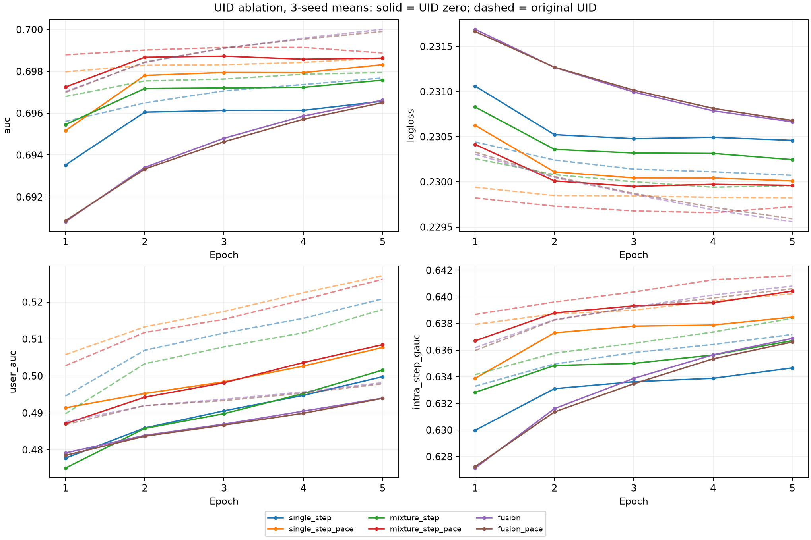

# UID置0：连续5轮逐epoch配对实验

**只把编码后的user_id输入置0，其余输入、模型形状、同seed初始化和训练协议不变。** 已完成6配置×3seed×5轮，90次完整test评估；与上一轮有UID的同seed、同配置、同epoch末结果配对。

## 改动与口径

- user_id对应padding_idx=0，Embedding第0行固定零向量。两套Omni和Fusion均被屏蔽；保留UID槽位和表形状以保持共有参数初始化完全一致。
- user_id_raw未改，仍按原始用户计算User-AUC；画像、用户预算先验及其余53字段保留。这是UID字段消融，不是移除全部用户相关信息。
- 置0发生在输入预处理，不在KRExitModel内部。重新加载本轮checkpoint预测时也必须使用zero_uid_inputs或等价处理，直接把原UID送入模型不属于本实验。
- 原始parquet和Schema未改；train截至2022-05-06为1,721,745请求，valid=05-07为57,872，test=05-08为48,898。沿用KR v3的原切分和物理训练顺序。
- 六配置、seed2026/2027/2028、batch4096、421步/轮、连续5轮共2105步；预算LR .005，内容/Fusion LR .001；一个AdamW，普通权重decay1e-6，Embedding/bias/一维参数零decay；clip10，无scheduler/EMA。
- Ours仍是乘积BCE联合训练，无辅助Loss、预热、冻结；每轮末完整valid/test，固定第5轮停止，不按test选点或回滚best。
- 本轮和对照均使用轮末权重；不与第14份预算内valid最优checkpoint混用。±为三个seed的样本标准差，非置信区间。

## 第5轮完整test

| 配置 | AUC ↑ | LogLoss ↓ | User-AUC ↑ | Intra-Step GAUC ↑ |
| --- | ---: | ---: | ---: | ---: |
| single_step | 0.696573 ± 0.000081 | 0.230459 ± 0.000013 | 0.499796 ± 0.001086 | 0.634664 ± 0.000035 |
| single_step_pace | 0.698315 ± 0.000311 | 0.230010 ± 0.000026 | 0.507694 ± 0.001657 | 0.638475 ± 0.000349 |
| mixture_step | 0.697579 ± 0.000480 | 0.230246 ± 0.000120 | 0.501583 ± 0.002347 | 0.636714 ± 0.000529 |
| mixture_step_pace | 0.698628 ± 0.000676 | 0.229961 ± 0.000136 | 0.508456 ± 0.001560 | 0.640428 ± 0.000863 |
| fusion | 0.696619 ± 0.000348 | 0.230665 ± 0.000072 | 0.493984 ± 0.003836 | 0.636878 ± 0.000546 |
| fusion_pace | 0.696504 ± 0.000285 | 0.230680 ± 0.000082 | 0.493941 ± 0.004170 | 0.636607 ± 0.000431 |

## 第5轮：置0减原UID（配对均值）

| 配置 | ΔAUC ↑ | ΔLogLoss ↓ | ΔUser-AUC ↑ | ΔIntra-Step GAUC ↑ | AUC改善seed数 |
| --- | ---: | ---: | ---: | ---: | ---: |
| single_step | -0.001107 | +0.000387 | -0.021071 | -0.002512 | 0/3 |
| single_step_pace | -0.000310 | +0.000187 | -0.019427 | -0.001754 | 1/3 |
| mixture_step | -0.000366 | +0.000289 | -0.016367 | -0.001669 | 0/3 |
| mixture_step_pace | -0.000248 | +0.000237 | -0.017726 | -0.001160 | 1/3 |
| fusion | -0.003386 | +0.001107 | -0.004197 | -0.003923 | 0/3 |
| fusion_pace | -0.003399 | +0.001090 | -0.003919 | -0.003999 | 0/3 |

第5轮AUC均值改善的配置数为0/6。这些结果衡量同一数据和训练协议下UID字段的增量，不等于移除用户画像或历史统计后的效果。

混合＋pace减Fusion的第5轮AUC均值差：原UID为-0.001130，置0后为+0.002008；置0后User-AUC均值差为+0.014472。不能将结构间相对差变化写成每个模型绝对表现均改善。

## 逐epoch曲线



实线为置0、虚线为原UID；均为三个seed均值，不是独立采样置信区间。

## 每轮完整结果与AUC配对差

| 配置 | epoch | test AUC | ΔAUC | test LogLoss | test User-AUC | test Intra-Step GAUC | valid LogLoss |
| --- | ---: | ---: | ---: | ---: | ---: | ---: | ---: |
| single_step | 1 | 0.693523 ± 0.000986 | -0.002083 | 0.231061 ± 0.000192 | 0.477756 ± 0.002003 | 0.629981 ± 0.001249 | 0.226788 ± 0.000226 |
| single_step | 2 | 0.696051 ± 0.000349 | -0.000439 | 0.230523 ± 0.000079 | 0.485918 ± 0.000880 | 0.633104 ± 0.000500 | 0.226037 ± 0.000062 |
| single_step | 3 | 0.696129 ± 0.000382 | -0.000936 | 0.230478 ± 0.000090 | 0.490563 ± 0.000428 | 0.633627 ± 0.000734 | 0.225837 ± 0.000080 |
| single_step | 4 | 0.696135 ± 0.000278 | -0.001233 | 0.230493 ± 0.000065 | 0.494743 ± 0.000497 | 0.633882 ± 0.000373 | 0.225649 ± 0.000104 |
| single_step | 5 | 0.696573 ± 0.000081 | -0.001107 | 0.230459 ± 0.000013 | 0.499796 ± 0.001086 | 0.634664 ± 0.000035 | 0.225530 ± 0.000094 |
| single_step_pace | 1 | 0.695165 ± 0.001050 | -0.002809 | 0.230626 ± 0.000192 | 0.491374 ± 0.001419 | 0.633878 ± 0.001417 | 0.226107 ± 0.000172 |
| single_step_pace | 2 | 0.697802 ± 0.000360 | -0.000487 | 0.230110 ± 0.000086 | 0.495255 ± 0.001076 | 0.637299 ± 0.000419 | 0.225356 ± 0.000051 |
| single_step_pace | 3 | 0.697944 ± 0.000238 | -0.000372 | 0.230044 ± 0.000073 | 0.498422 ± 0.001069 | 0.637799 ± 0.000557 | 0.225111 ± 0.000072 |
| single_step_pace | 4 | 0.697938 ± 0.000104 | -0.000488 | 0.230042 ± 0.000024 | 0.502665 ± 0.001461 | 0.637880 ± 0.000204 | 0.224946 ± 0.000076 |
| single_step_pace | 5 | 0.698315 ± 0.000311 | -0.000310 | 0.230010 ± 0.000026 | 0.507694 ± 0.001657 | 0.638475 ± 0.000349 | 0.224840 ± 0.000069 |
| mixture_step | 1 | 0.695456 ± 0.000167 | -0.001338 | 0.230829 ± 0.000039 | 0.475071 ± 0.000463 | 0.632830 ± 0.000317 | 0.226584 ± 0.000041 |
| mixture_step | 2 | 0.697178 ± 0.000115 | -0.000362 | 0.230360 ± 0.000035 | 0.485801 ± 0.000877 | 0.634844 ± 0.000295 | 0.226020 ± 0.000027 |
| mixture_step | 3 | 0.697205 ± 0.000212 | -0.000425 | 0.230319 ± 0.000010 | 0.489791 ± 0.001230 | 0.635004 ± 0.000089 | 0.225726 ± 0.000052 |
| mixture_step | 4 | 0.697234 ± 0.000241 | -0.000624 | 0.230315 ± 0.000065 | 0.495236 ± 0.002781 | 0.635633 ± 0.000059 | 0.225482 ± 0.000108 |
| mixture_step | 5 | 0.697579 ± 0.000480 | -0.000366 | 0.230246 ± 0.000120 | 0.501583 ± 0.002347 | 0.636714 ± 0.000529 | 0.225315 ± 0.000110 |
| mixture_step_pace | 1 | 0.697249 ± 0.000277 | -0.001538 | 0.230414 ± 0.000024 | 0.487065 ± 0.000446 | 0.636698 ± 0.000352 | 0.225943 ± 0.000043 |
| mixture_step_pace | 2 | 0.698670 ± 0.000156 | -0.000344 | 0.230010 ± 0.000023 | 0.494243 ± 0.001511 | 0.638793 ± 0.000219 | 0.225326 ± 0.000016 |
| mixture_step_pace | 3 | 0.698722 ± 0.000141 | -0.000419 | 0.229950 ± 0.000014 | 0.498163 ± 0.002221 | 0.639321 ± 0.000255 | 0.225022 ± 0.000047 |
| mixture_step_pace | 4 | 0.698576 ± 0.000419 | -0.000565 | 0.229973 ± 0.000104 | 0.503610 ± 0.002713 | 0.639559 ± 0.000501 | 0.224813 ± 0.000070 |
| mixture_step_pace | 5 | 0.698628 ± 0.000676 | -0.000248 | 0.229961 ± 0.000136 | 0.508456 ± 0.001560 | 0.640428 ± 0.000863 | 0.224663 ± 0.000055 |
| fusion | 1 | 0.690816 ± 0.000737 | -0.006215 | 0.231690 ± 0.000182 | 0.479168 ± 0.000834 | 0.627142 ± 0.001202 | 0.227576 ± 0.000170 |
| fusion | 2 | 0.693409 ± 0.000167 | -0.005012 | 0.231269 ± 0.000086 | 0.483916 ± 0.002999 | 0.631606 ± 0.000591 | 0.226963 ± 0.000098 |
| fusion | 3 | 0.694801 ± 0.000096 | -0.004300 | 0.230995 ± 0.000059 | 0.486955 ± 0.003760 | 0.633878 ± 0.000448 | 0.226686 ± 0.000104 |
| fusion | 4 | 0.695862 ± 0.000240 | -0.003722 | 0.230788 ± 0.000066 | 0.490480 ± 0.004019 | 0.635647 ± 0.000407 | 0.226471 ± 0.000095 |
| fusion | 5 | 0.696619 ± 0.000348 | -0.003386 | 0.230665 ± 0.000072 | 0.493984 ± 0.003836 | 0.636878 ± 0.000546 | 0.226289 ± 0.000076 |
| fusion_pace | 1 | 0.690860 ± 0.000733 | -0.006130 | 0.231666 ± 0.000184 | 0.478510 ± 0.000319 | 0.627250 ± 0.001041 | 0.227549 ± 0.000180 |
| fusion_pace | 2 | 0.693332 ± 0.000182 | -0.005110 | 0.231271 ± 0.000095 | 0.483684 ± 0.003026 | 0.631358 ± 0.000734 | 0.226955 ± 0.000139 |
| fusion_pace | 3 | 0.694634 ± 0.000143 | -0.004478 | 0.231016 ± 0.000086 | 0.486696 ± 0.003369 | 0.633474 ± 0.000472 | 0.226685 ± 0.000146 |
| fusion_pace | 4 | 0.695710 ± 0.000210 | -0.003823 | 0.230814 ± 0.000078 | 0.489894 ± 0.003798 | 0.635344 ± 0.000445 | 0.226476 ± 0.000119 |
| fusion_pace | 5 | 0.696504 ± 0.000285 | -0.003399 | 0.230680 ± 0.000082 | 0.493941 ± 0.004170 | 0.636607 ± 0.000431 | 0.226288 ± 0.000105 |

## 第5轮逐seed配对

| seed | 配置 | 原AUC | 置0 AUC | ΔAUC | 置0 LogLoss | 原User-AUC | 置0 User-AUC |
| ---: | --- | ---: | ---: | ---: | ---: | ---: | ---: |
| 2026 | fusion | 0.700359 | 0.696353 | -0.004006 | 0.230722 | 0.498219 | 0.489881 |
| 2026 | fusion_pace | 0.700317 | 0.696274 | -0.004043 | 0.230756 | 0.498898 | 0.489126 |
| 2026 | mixture_step | 0.697400 | 0.697036 | -0.000364 | 0.230384 | 0.524057 | 0.501915 |
| 2026 | mixture_step_pace | 0.698421 | 0.698116 | -0.000305 | 0.230066 | 0.527895 | 0.507547 |
| 2026 | single_step | 0.697928 | 0.696654 | -0.001274 | 0.230474 | 0.521378 | 0.499179 |
| 2026 | single_step_pace | 0.698842 | 0.698479 | -0.000363 | 0.230025 | 0.525874 | 0.507057 |
| 2027 | fusion | 0.699653 | 0.697013 | -0.002640 | 0.230584 | 0.496448 | 0.494589 |
| 2027 | fusion_pace | 0.699461 | 0.696823 | -0.002638 | 0.230593 | 0.496252 | 0.496298 |
| 2027 | mixture_step | 0.698104 | 0.697950 | -0.000154 | 0.230175 | 0.513207 | 0.499088 |
| 2027 | mixture_step_pace | 0.698641 | 0.699395 | +0.000754 | 0.229808 | 0.524408 | 0.507564 |
| 2027 | single_step | 0.697523 | 0.696573 | -0.000950 | 0.230448 | 0.522819 | 0.499159 |
| 2027 | single_step_pace | 0.698456 | 0.698510 | +0.000054 | 0.229980 | 0.526993 | 0.506450 |
| 2028 | fusion | 0.700004 | 0.696492 | -0.003512 | 0.230690 | 0.499874 | 0.497481 |
| 2028 | fusion_pace | 0.699933 | 0.696416 | -0.003518 | 0.230691 | 0.498429 | 0.496398 |
| 2028 | mixture_step | 0.698330 | 0.697749 | -0.000580 | 0.230179 | 0.516587 | 0.503747 |
| 2028 | mixture_step_pace | 0.699565 | 0.698373 | -0.001192 | 0.230008 | 0.526241 | 0.510257 |
| 2028 | single_step | 0.697590 | 0.696491 | -0.001099 | 0.230456 | 0.518405 | 0.501049 |
| 2028 | single_step_pace | 0.698579 | 0.697957 | -0.000622 | 0.230026 | 0.528496 | 0.509576 |

## 审计与解释边界

- 所有配置同seed初始完整模型hash与原对照一致，optimizer groups一致。输入审计逐张量确认只改user_id；raw UID与用户内AUC有效覆盖未变。
- 90份checkpoint的两套UID表从初始化起逐字节未变，第0行恒0；模型/优化器/RNG在评估前后不变，各轮Adam step连续。
- 重新读取180份valid/test预测核对完整请求元数据及全部指标（绝对容差1e-12），Ours乘积逐值相等。原对照180份预测哈希未变。
- 真实checkpoint重载复核覆盖2个配置（记录见下方链接）；显式置0后完整test所有预测列与已保存产物逐值一致。
- 这是固定KR v3切分的配对特征消融，不能把观察到的改善自动解释为某种因果退出机制，也不能据此声称跨用户泛化或线上收益。没有新增bootstrap或独立test。

## 产物与复现

- [训练日志](../../runs/epochwise5_uid_zero/logs/train.log) · [配置](../../runs/epochwise5_uid_zero/config.json) · [全部原始指标](../../runs/epochwise5_uid_zero/summary.json) · [输入审计](../../runs/epochwise5_uid_zero/input_audit.json) · [独立审计](../../runs/epochwise5_uid_zero/audit.json)。
- [逐seed逐轮配对差](../../runs/epochwise5_uid_zero/paired_deltas.parquet) · [原UID对照报告](逐epoch5轮实验报告.md)。
- [checkpoint重载复核](../../runs/epochwise5_uid_zero/checkpoint_reload.json) · [测试日志](../../runs/epochwise5_uid_zero/logs/tests.log)。
- [训练入口](../../pipeline/run_uid_zero.py) · [只读报告](../../pipeline/report_uid_zero.py) · [实验说明](UID置0实验说明.md)。

```bash
uv run python -m workspace.kr_time_budget.pipeline.run_uid_zero --output workspace/kr_time_budget/runs/epochwise5_uid_zero_new
uv run python -m workspace.kr_time_budget.pipeline.report_uid_zero
```
