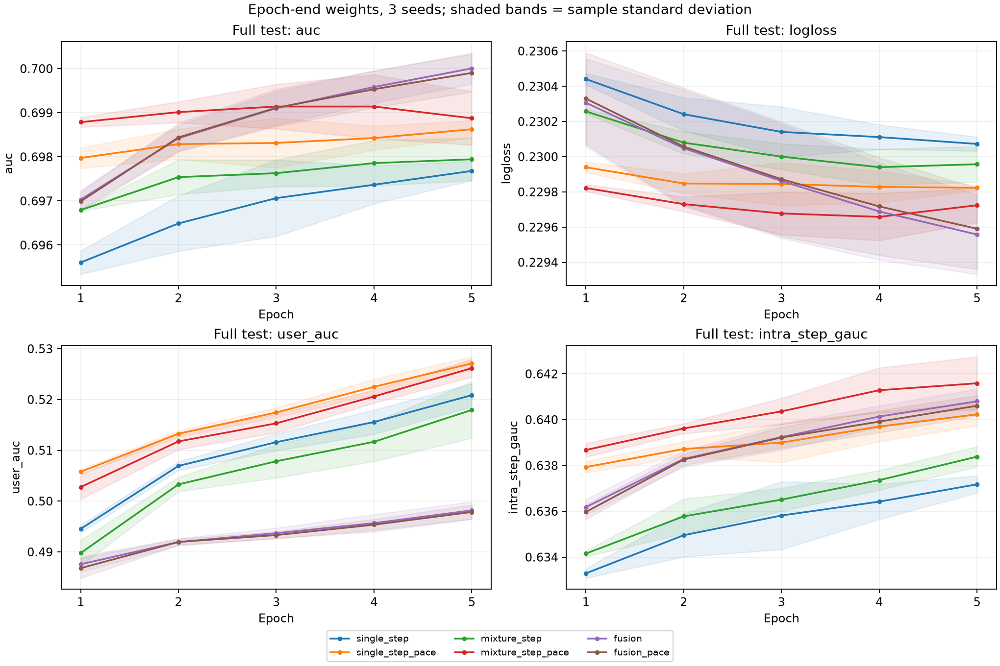

# 连续训练5轮：逐epoch完整test结果

**已完成六配置×三seed共18条连续5epoch轨迹；每轮末直接测完整test，共90次。** 每条2105个optimizer step，没有轮间恢复best、重置优化器或按test提前停止。

本轮使用当前轮末权重，区别于第13/14份“训练预算内完整valid最优checkpoint”。不能将两种口径的曲线和数值混称为同一个结果。

## 数据与训练口径

- KR v3：train截至2022-05-06为1,721,745请求，valid=05-07为57,872，test=05-08为48,898；数据与train-fit schema不变。
- 配置：单/混合威布尔各自有无pace，Fusion及Fusion+pace；seed2026/2027/2028。
- 原模型、原输入路由、同一train物理顺序每轮重复；batch4096，每轮421步，累积梯度1，CPU4线程。
- 一个AdamW；预算LR0.005，内容/Fusion LR0.001；普通权重decay1e-6，Embedding/bias/一维参数零decay；无scheduler/EMA。Ours从第一步起使用乘积BCE联合训练，无预热、冻结或辅助loss。
- 每轮完整valid/test只作观测；固定第5轮结束停止。额外记录轮末valid最优epoch，不据此回滚；不按test选模型。
- User-AUC为用户内AUC按请求数加权，剔除单标签用户；Intra-Step GAUC按确切屏号分组。±是三个seed样本标准差，不是置信区间。

## 逐轮曲线



## 第5轮完整test

| 配置 | Pooled AUC ↑ | LogLoss ↓ | User-AUC ↑ | Intra-Step GAUC ↑ |
| --- | ---: | ---: | ---: | ---: |
| single_step | 0.697680 ± 0.000217 | 0.230072 ± 0.000040 | 0.520867 ± 0.002251 | 0.637176 ± 0.000377 |
| single_step_pace | 0.698625 ± 0.000197 | 0.229823 ± 0.000013 | 0.527121 ± 0.001316 | 0.640229 ± 0.000494 |
| mixture_step | 0.697945 ± 0.000485 | 0.229957 ± 0.000101 | 0.517950 ± 0.005552 | 0.638383 ± 0.000446 |
| mixture_step_pace | 0.698876 ± 0.000607 | 0.229724 ± 0.000097 | 0.526181 ± 0.001744 | 0.641588 ± 0.001161 |
| fusion | 0.700005 ± 0.000353 | 0.229558 ± 0.000226 | 0.498180 ± 0.001714 | 0.640801 ± 0.000538 |
| fusion_pace | 0.699904 ± 0.000429 | 0.229591 ± 0.000230 | 0.497860 ± 0.001411 | 0.640606 ± 0.000450 |

第5轮均值中，AUC最高配置为`fusion`，LogLoss最低为`fusion`，User-AUC最高为`single_step_pace`。这是固定test上的描述性排名，不是统计显著性结论。

第5轮混合＋pace减Fusion：auc -0.001130, logloss +0.000166, user_auc +0.028001, intra_step_gauc +0.000787。应同时看总体排序、概率误差和用户内排序，不能用某一项代替全部指标。

## 第3轮到第5轮变化（均值）

| 配置 | ΔAUC ↑ | ΔLogLoss ↓ | ΔUser-AUC ↑ | ΔIntra-Step GAUC ↑ |
| --- | ---: | ---: | ---: | ---: |
| single_step | +0.000616 | -0.000068 | +0.009264 | +0.001360 |
| single_step_pace | +0.000310 | -0.000022 | +0.009671 | +0.001231 |
| mixture_step | +0.000315 | -0.000043 | +0.010101 | +0.001875 |
| mixture_step_pace | -0.000265 | +0.000047 | +0.010864 | +0.001227 |
| fusion | +0.000903 | -0.000304 | +0.004487 | +0.001563 |
| fusion_pace | +0.000792 | -0.000282 | +0.004542 | +0.001386 |

## 完整逐epoch表

| 配置 | epoch | test AUC | test LogLoss | test User-AUC | test Intra-Step GAUC | valid LogLoss |
| --- | ---: | ---: | ---: | ---: | ---: | ---: |
| single_step | 1 | 0.695606 ± 0.000267 | 0.230441 ± 0.000032 | 0.494541 ± 0.000762 | 0.633289 ± 0.000207 | 0.225627 ± 0.000063 |
| single_step | 2 | 0.696490 ± 0.000628 | 0.230241 ± 0.000094 | 0.506939 ± 0.000870 | 0.634954 ± 0.000943 | 0.225303 ± 0.000010 |
| single_step | 3 | 0.697065 ± 0.000867 | 0.230141 ± 0.000143 | 0.511603 ± 0.001666 | 0.635815 ± 0.001482 | 0.225207 ± 0.000015 |
| single_step | 4 | 0.697368 ± 0.000431 | 0.230112 ± 0.000070 | 0.515580 ± 0.002397 | 0.636421 ± 0.000770 | 0.225130 ± 0.000057 |
| single_step | 5 | 0.697680 ± 0.000217 | 0.230072 ± 0.000040 | 0.520867 ± 0.002251 | 0.637176 ± 0.000377 | 0.225054 ± 0.000093 |
| single_step_pace | 1 | 0.697974 ± 0.000234 | 0.229940 ± 0.000031 | 0.505776 ± 0.000526 | 0.637929 ± 0.000253 | 0.224951 ± 0.000066 |
| single_step_pace | 2 | 0.698289 ± 0.000342 | 0.229848 ± 0.000056 | 0.513282 ± 0.000622 | 0.638721 ± 0.000327 | 0.224659 ± 0.000035 |
| single_step_pace | 3 | 0.698316 ± 0.000564 | 0.229845 ± 0.000122 | 0.517450 ± 0.000952 | 0.638997 ± 0.000861 | 0.224627 ± 0.000035 |
| single_step_pace | 4 | 0.698426 ± 0.000273 | 0.229828 ± 0.000090 | 0.522500 ± 0.001535 | 0.639698 ± 0.000658 | 0.224596 ± 0.000060 |
| single_step_pace | 5 | 0.698625 ± 0.000197 | 0.229823 ± 0.000013 | 0.527121 ± 0.001316 | 0.640229 ± 0.000494 | 0.224564 ± 0.000056 |
| mixture_step | 1 | 0.696794 ± 0.000022 | 0.230257 ± 0.000012 | 0.489782 ± 0.002533 | 0.634153 ± 0.000130 | 0.225555 ± 0.000035 |
| mixture_step | 2 | 0.697540 ± 0.000395 | 0.230080 ± 0.000063 | 0.503294 ± 0.001399 | 0.635778 ± 0.000762 | 0.225279 ± 0.000019 |
| mixture_step | 3 | 0.697630 ± 0.000303 | 0.230000 ± 0.000074 | 0.507849 ± 0.003279 | 0.636508 ± 0.000502 | 0.225188 ± 0.000036 |
| mixture_step | 4 | 0.697858 ± 0.000514 | 0.229940 ± 0.000103 | 0.511687 ± 0.003865 | 0.637358 ± 0.000432 | 0.225019 ± 0.000075 |
| mixture_step | 5 | 0.697945 ± 0.000485 | 0.229957 ± 0.000101 | 0.517950 ± 0.005552 | 0.638383 ± 0.000446 | 0.224885 ± 0.000094 |
| mixture_step_pace | 1 | 0.698786 ± 0.000110 | 0.229822 ± 0.000020 | 0.502767 ± 0.002406 | 0.638676 ± 0.000301 | 0.224927 ± 0.000029 |
| mixture_step_pace | 2 | 0.699015 ± 0.000237 | 0.229730 ± 0.000042 | 0.511761 ± 0.001616 | 0.639615 ± 0.000221 | 0.224616 ± 0.000020 |
| mixture_step_pace | 3 | 0.699141 ± 0.000506 | 0.229678 ± 0.000121 | 0.515317 ± 0.001836 | 0.640361 ± 0.000571 | 0.224545 ± 0.000027 |
| mixture_step_pace | 4 | 0.699141 ± 0.000722 | 0.229658 ± 0.000134 | 0.520597 ± 0.001278 | 0.641284 ± 0.000984 | 0.224490 ± 0.000032 |
| mixture_step_pace | 5 | 0.698876 ± 0.000607 | 0.229724 ± 0.000097 | 0.526181 ± 0.001744 | 0.641588 ± 0.001161 | 0.224487 ± 0.000067 |
| fusion | 1 | 0.697031 ± 0.000212 | 0.230307 ± 0.000250 | 0.487571 ± 0.001504 | 0.636181 ± 0.000345 | 0.225998 ± 0.000234 |
| fusion | 2 | 0.698422 ± 0.000290 | 0.230048 ± 0.000331 | 0.491953 ± 0.000699 | 0.638286 ± 0.000349 | 0.225568 ± 0.000298 |
| fusion | 3 | 0.699102 ± 0.000381 | 0.229862 ± 0.000324 | 0.493693 ± 0.001021 | 0.639239 ± 0.000567 | 0.225381 ± 0.000284 |
| fusion | 4 | 0.699584 ± 0.000366 | 0.229689 ± 0.000276 | 0.495674 ± 0.001718 | 0.640136 ± 0.000476 | 0.225203 ± 0.000255 |
| fusion | 5 | 0.700005 ± 0.000353 | 0.229558 ± 0.000226 | 0.498180 ± 0.001714 | 0.640801 ± 0.000538 | 0.225037 ± 0.000219 |
| fusion_pace | 1 | 0.696990 ± 0.000216 | 0.230330 ± 0.000260 | 0.486812 ± 0.001961 | 0.635971 ± 0.000321 | 0.226011 ± 0.000255 |
| fusion_pace | 2 | 0.698441 ± 0.000324 | 0.230058 ± 0.000333 | 0.491966 ± 0.000601 | 0.638255 ± 0.000246 | 0.225575 ± 0.000307 |
| fusion_pace | 3 | 0.699112 ± 0.000422 | 0.229872 ± 0.000325 | 0.493318 ± 0.000670 | 0.639219 ± 0.000461 | 0.225379 ± 0.000292 |
| fusion_pace | 4 | 0.699533 ± 0.000417 | 0.229718 ± 0.000278 | 0.495358 ± 0.001083 | 0.639913 ± 0.000478 | 0.225206 ± 0.000250 |
| fusion_pace | 5 | 0.699904 ± 0.000429 | 0.229591 ± 0.000230 | 0.497860 ± 0.001411 | 0.640606 ± 0.000450 | 0.225034 ± 0.000210 |

## 逐seed结果

| seed | 配置 | epoch | test AUC | test LogLoss | test User-AUC | test Intra-Step GAUC |
| ---: | --- | ---: | ---: | ---: | ---: | ---: |
| 2026 | fusion | 1 | 0.696801 | 0.230044 | 0.489217 | 0.635786 |
| 2026 | fusion | 2 | 0.698672 | 0.229695 | 0.492698 | 0.638395 |
| 2026 | fusion | 3 | 0.699482 | 0.229537 | 0.494212 | 0.639462 |
| 2026 | fusion | 4 | 0.699946 | 0.229440 | 0.495986 | 0.640474 |
| 2026 | fusion | 5 | 0.700359 | 0.229360 | 0.498219 | 0.641114 |
| 2026 | fusion_pace | 1 | 0.696754 | 0.230042 | 0.489064 | 0.635627 |
| 2026 | fusion_pace | 2 | 0.698713 | 0.229696 | 0.492645 | 0.638481 |
| 2026 | fusion_pace | 3 | 0.699503 | 0.229542 | 0.493870 | 0.639492 |
| 2026 | fusion_pace | 4 | 0.699914 | 0.229453 | 0.496259 | 0.640207 |
| 2026 | fusion_pace | 5 | 0.700317 | 0.229377 | 0.498898 | 0.640877 |
| 2026 | mixture_step | 1 | 0.696791 | 0.230248 | 0.491530 | 0.634050 |
| 2026 | mixture_step | 2 | 0.697155 | 0.230150 | 0.504769 | 0.634936 |
| 2026 | mixture_step | 3 | 0.697280 | 0.230085 | 0.511597 | 0.636091 |
| 2026 | mixture_step | 4 | 0.697272 | 0.230058 | 0.515915 | 0.636879 |
| 2026 | mixture_step | 5 | 0.697400 | 0.230073 | 0.524057 | 0.637975 |
| 2026 | mixture_step_pace | 1 | 0.698907 | 0.229805 | 0.504344 | 0.638862 |
| 2026 | mixture_step_pace | 2 | 0.698850 | 0.229778 | 0.512983 | 0.639390 |
| 2026 | mixture_step_pace | 3 | 0.698571 | 0.229814 | 0.517348 | 0.639721 |
| 2026 | mixture_step_pace | 4 | 0.698539 | 0.229771 | 0.521874 | 0.640357 |
| 2026 | mixture_step_pace | 5 | 0.698421 | 0.229805 | 0.527895 | 0.640927 |
| 2026 | single_step | 1 | 0.695455 | 0.230465 | 0.495385 | 0.633215 |
| 2026 | single_step | 2 | 0.696038 | 0.230326 | 0.507066 | 0.634189 |
| 2026 | single_step | 3 | 0.696286 | 0.230286 | 0.511376 | 0.634489 |
| 2026 | single_step | 4 | 0.696887 | 0.230192 | 0.515465 | 0.635638 |
| 2026 | single_step | 5 | 0.697928 | 0.230033 | 0.521378 | 0.637368 |
| 2026 | single_step_pace | 1 | 0.697942 | 0.229957 | 0.505497 | 0.637869 |
| 2026 | single_step_pace | 2 | 0.698167 | 0.229889 | 0.512574 | 0.638370 |
| 2026 | single_step_pace | 3 | 0.697980 | 0.229936 | 0.516358 | 0.638246 |
| 2026 | single_step_pace | 4 | 0.698112 | 0.229928 | 0.520728 | 0.638988 |
| 2026 | single_step_pace | 5 | 0.698842 | 0.229809 | 0.525874 | 0.640026 |
| 2027 | fusion | 1 | 0.697219 | 0.230541 | 0.486269 | 0.636333 |
| 2027 | fusion | 2 | 0.698104 | 0.230352 | 0.491313 | 0.637896 |
| 2027 | fusion | 3 | 0.698719 | 0.230186 | 0.492517 | 0.638594 |
| 2027 | fusion | 4 | 0.699215 | 0.229985 | 0.493821 | 0.639592 |
| 2027 | fusion | 5 | 0.699653 | 0.229804 | 0.496448 | 0.640180 |
| 2027 | fusion_pace | 1 | 0.697179 | 0.230547 | 0.485482 | 0.636261 |
| 2027 | fusion_pace | 2 | 0.698083 | 0.230352 | 0.491753 | 0.637993 |
| 2027 | fusion_pace | 3 | 0.698665 | 0.230192 | 0.492573 | 0.638687 |
| 2027 | fusion_pace | 4 | 0.699087 | 0.230007 | 0.494157 | 0.639362 |
| 2027 | fusion_pace | 5 | 0.699461 | 0.229835 | 0.496252 | 0.640086 |
| 2027 | mixture_step | 1 | 0.696774 | 0.230271 | 0.486877 | 0.634109 |
| 2027 | mixture_step | 2 | 0.697944 | 0.230029 | 0.501987 | 0.636419 |
| 2027 | mixture_step | 3 | 0.697812 | 0.229970 | 0.505506 | 0.637065 |
| 2027 | mixture_step | 4 | 0.698071 | 0.229871 | 0.508334 | 0.637719 |
| 2027 | mixture_step | 5 | 0.698104 | 0.229886 | 0.513207 | 0.638314 |
| 2027 | mixture_step_pace | 1 | 0.698691 | 0.229844 | 0.499998 | 0.638328 |
| 2027 | mixture_step_pace | 2 | 0.699286 | 0.229697 | 0.509928 | 0.639832 |
| 2027 | mixture_step_pace | 3 | 0.699313 | 0.229637 | 0.513775 | 0.640817 |
| 2027 | mixture_step_pace | 4 | 0.698941 | 0.229693 | 0.519318 | 0.641179 |
| 2027 | mixture_step_pace | 5 | 0.698641 | 0.229751 | 0.524408 | 0.640909 |
| 2027 | single_step | 1 | 0.695915 | 0.230405 | 0.493904 | 0.633522 |
| 2027 | single_step | 2 | 0.697208 | 0.230140 | 0.507738 | 0.636008 |
| 2027 | single_step | 3 | 0.697999 | 0.230001 | 0.513371 | 0.637415 |
| 2027 | single_step | 4 | 0.697719 | 0.230067 | 0.518032 | 0.637177 |
| 2027 | single_step | 5 | 0.697523 | 0.230113 | 0.522819 | 0.636742 |
| 2027 | single_step_pace | 1 | 0.698222 | 0.229905 | 0.505448 | 0.638206 |
| 2027 | single_step_pace | 2 | 0.698675 | 0.229784 | 0.513532 | 0.639017 |
| 2027 | single_step_pace | 3 | 0.698967 | 0.229706 | 0.518098 | 0.639937 |
| 2027 | single_step_pace | 4 | 0.698603 | 0.229754 | 0.523375 | 0.639821 |
| 2027 | single_step_pace | 5 | 0.698456 | 0.229830 | 0.526993 | 0.639868 |
| 2028 | fusion | 1 | 0.697071 | 0.230335 | 0.487227 | 0.636424 |
| 2028 | fusion | 2 | 0.698489 | 0.230098 | 0.491848 | 0.638568 |
| 2028 | fusion | 3 | 0.699104 | 0.229863 | 0.494350 | 0.639660 |
| 2028 | fusion | 4 | 0.699590 | 0.229641 | 0.497214 | 0.640343 |
| 2028 | fusion | 5 | 0.700004 | 0.229510 | 0.499874 | 0.641109 |
| 2028 | fusion_pace | 1 | 0.697038 | 0.230401 | 0.485888 | 0.636025 |
| 2028 | fusion_pace | 2 | 0.698528 | 0.230125 | 0.491501 | 0.638290 |
| 2028 | fusion_pace | 3 | 0.699168 | 0.229883 | 0.493511 | 0.639479 |
| 2028 | fusion_pace | 4 | 0.699596 | 0.229693 | 0.495659 | 0.640171 |
| 2028 | fusion_pace | 5 | 0.699933 | 0.229560 | 0.498429 | 0.640854 |
| 2028 | mixture_step | 1 | 0.696817 | 0.230253 | 0.490940 | 0.634299 |
| 2028 | mixture_step | 2 | 0.697522 | 0.230061 | 0.503126 | 0.635978 |
| 2028 | mixture_step | 3 | 0.697798 | 0.229946 | 0.506444 | 0.636368 |
| 2028 | mixture_step | 4 | 0.698231 | 0.229892 | 0.510813 | 0.637475 |
| 2028 | mixture_step | 5 | 0.698330 | 0.229913 | 0.516587 | 0.638858 |
| 2028 | mixture_step_pace | 1 | 0.698761 | 0.229817 | 0.503961 | 0.638837 |
| 2028 | mixture_step_pace | 2 | 0.698907 | 0.229717 | 0.512371 | 0.639624 |
| 2028 | mixture_step_pace | 3 | 0.699539 | 0.229582 | 0.514828 | 0.640546 |
| 2028 | mixture_step_pace | 4 | 0.699942 | 0.229510 | 0.520599 | 0.642316 |
| 2028 | mixture_step_pace | 5 | 0.699565 | 0.229617 | 0.526241 | 0.642928 |
| 2028 | single_step | 1 | 0.695449 | 0.230454 | 0.494333 | 0.633129 |
| 2028 | single_step | 2 | 0.696225 | 0.230258 | 0.506012 | 0.634665 |
| 2028 | single_step | 3 | 0.696909 | 0.230135 | 0.510063 | 0.635541 |
| 2028 | single_step | 4 | 0.697498 | 0.230076 | 0.513242 | 0.636447 |
| 2028 | single_step | 5 | 0.697590 | 0.230072 | 0.518405 | 0.637418 |
| 2028 | single_step_pace | 1 | 0.697757 | 0.229959 | 0.506383 | 0.637712 |
| 2028 | single_step_pace | 2 | 0.698025 | 0.229870 | 0.513740 | 0.638775 |
| 2028 | single_step_pace | 3 | 0.698000 | 0.229892 | 0.517895 | 0.638810 |
| 2028 | single_step_pace | 4 | 0.698564 | 0.229803 | 0.523397 | 0.640285 |
| 2028 | single_step_pace | 5 | 0.698579 | 0.229831 | 0.528496 | 0.640792 |

## 审计与边界

- 18条轨迹第1、第3轮末模型hash均与第13份保存的对应terminal hash完全一致；不是与预算内best混比。新增逐轮test观测未改变历史前三轮训练轨迹。
- 每次评估前后模型hash、optimizer moment hash、Torch RNG均相同；各轮checkpoint保存同一时点模型及Adam状态，step计数为421/842/1263/1684/2105。
- 独立读取全部90份checkpoint核对模型hash和Adam step；读取180份valid/test预测，逐列核对请求/会话/用户/屏号/标签及覆盖。全部重算指标通过1e-12绝对容差，最大差异3.33e-16（分组浮点求和顺序）；Ours乘积逐值相等。
- 本轮逐epoch观测的是反复查看过的固定test，不新增独立测试样本，不做显著性或因果/线上收益判断。曲线改善也不能证明已达到模型上限。
- 屏末pace和离线分屏边界仍按原实验保留，详见[第18份审阅](17与18审阅.md)。

## 证据与复现

- [训练日志](../../runs/epochwise5/logs/train.log) · [配置](../../runs/epochwise5/config.json) · [覆盖](../../runs/epochwise5/coverage.json) · [完整逐轮原始指标](../../runs/epochwise5/summary.json)。
- [审计](../../runs/epochwise5/audit.json) · [聚合数据](../../runs/epochwise5/epoch_aggregates.parquet) · [训练入口](../../pipeline/run_epochwise_exit.py) · [只读报告生成](../../pipeline/report_epochwise_exit.py)。
- [实验说明](逐epoch5轮实验说明.md)。模型、预处理和已有run未修改。

仓库根目录运行（训练输出须为全新目录）：

```bash
uv run python -m workspace.kr_time_budget.pipeline.run_epochwise_exit --output workspace/kr_time_budget/runs/epochwise5_new
uv run python -m workspace.kr_time_budget.pipeline.report_epochwise_exit
```
