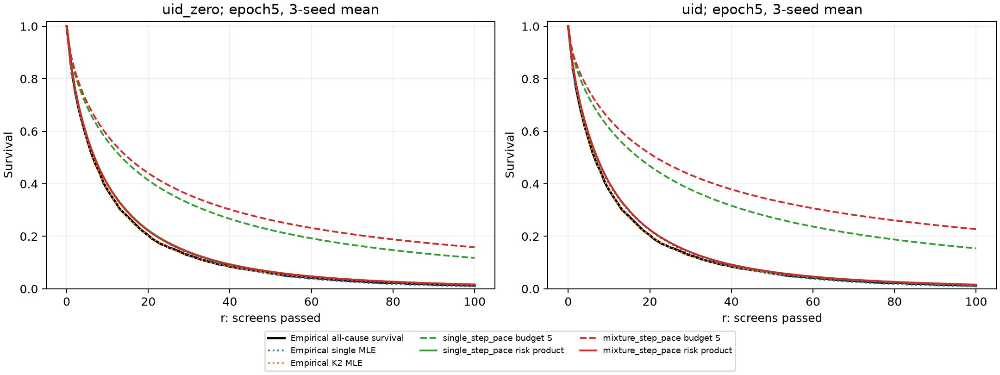
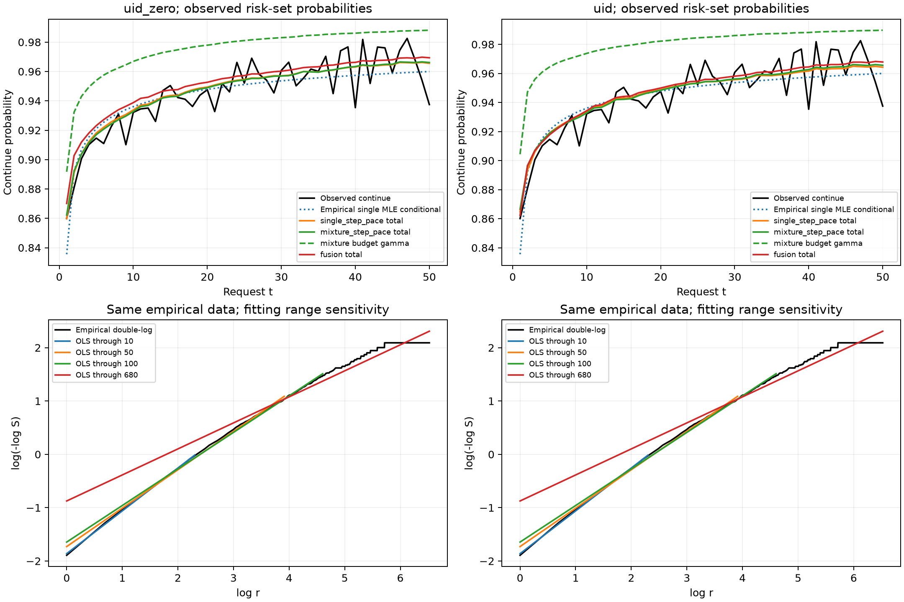
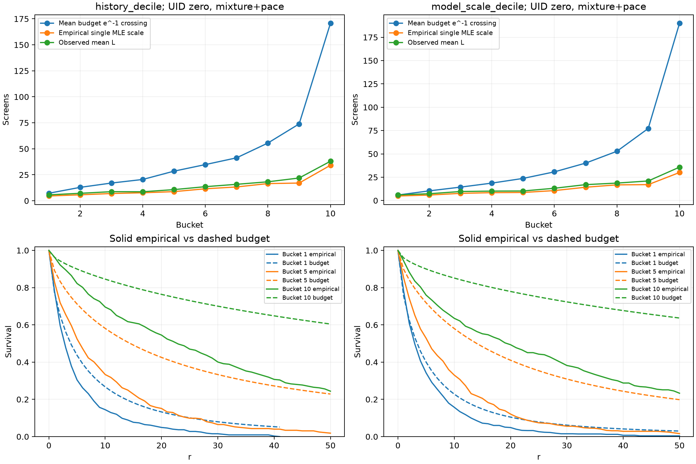
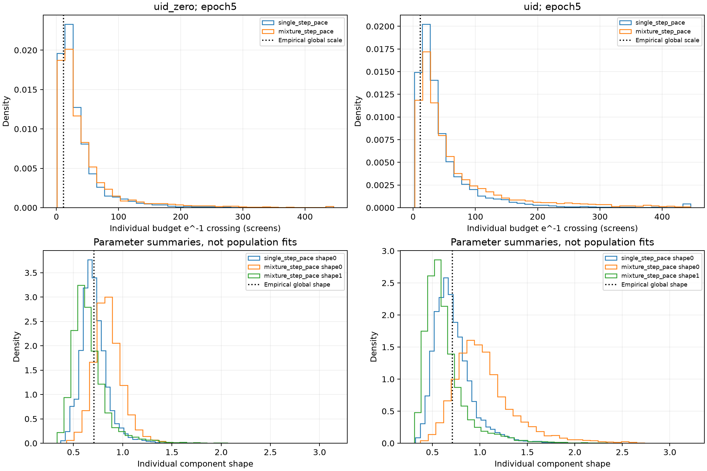

# 测试集行为威布尔拟合与模型核对

**本轮没有重训。** 直接统计KR v3完整test的3,281场、48,898请求；复用既有预测，并对72个已有checkpoint各运行一次首屏预算参数读取。当前UID置0和原UID均覆盖，主看第5轮，第1/3轮作敏感性。

结论：真实总停止屏数可被单/混合Weibull近似描述；预算分支尺度与桶级真实长度有正向关系，但预算S本身与总退出曲线存在明显差距。最终继续概率在已观察风险集上的累计曲线接近经验曲线，不能把它升级为外生预算被识别或未观察轨迹已校准的结论。

## 1. 口径与要回答的问题

真实停止屏数L取每场最大req_idx；每场一个观测，不能对单条请求或单场直接估计“真实lambda和shape”。经验S(r)=P(L>r)，r=0时为1；第t屏之后继续的经验概率是S(t)/S(t−1)。模型用r=t−1输入预算，gamma=S_budget(t)/S_budget(t−1)。

必须分开比较：①总退出分布是否近似Weibull；②预算分支的群体曲线是否等于总退出曲线；③最终继续概率在真实风险集上是否贴近观察。②在乘积分解下本就不是与①同一个目标，数值不同不能直接判为实现错误，也不能自动判为识别成功。

## 2. 真实停止屏数的经验拟合

| 拟合 | scale（屏） | shape | 权重 | 0–50屏生存RMSE | 0–50屏R² |
| --- | --- | --- | --- | ---: | ---: |
| 离散单Weibull MLE | 11.275721 | 0.708536 | 1.0000 | 0.013349 | 0.996333 |
| 离散K=2 MLE | 7.071885, 17.077999 | 0.881819, 0.709618 | 0.5067, 0.4933 | 0.002096 | 0.999910 |

MLE使用离散概率P(L=l)=S(l−1)−S(l)，包含L=1，不把整数屏数当连续密度。这是对test本身的描述性拟合，R²是同样本、累计曲线点的拟合指标，不是独立验证，更不是分布检验的通过概率。K=2额外参数更多，拟合误差较小也不能直接当作预测泛化收益。

| 双对数OLS拟合范围 | scale | shape | 点数 |
| --- | ---: | ---: | ---: |
| 1–10屏 | 10.179128 | 0.802761 | 10 |
| 1–50屏 | 11.045307 | 0.720010 | 50 |
| 1–100屏 | 11.024400 | 0.685468 | 100 |
| 1–680屏 | 6.000293 | 0.488062 | 680 |

平均停止屏数为14.903383，最大681屏。前50屏OLS确实给出约0.72，但随拟合范围变化，shape明显改变；不能把局部斜率与网络参数均值相近写成“全分布已高度吻合”的铁证。

## 3. 全局曲线：预算S与总继续概率分开



| UID | 模型 | 经验MLE scale | 模型预算e^-1交点均值 | 模型第0分量shape均值 | 预算S RMSE₀₋₅₀ | 总概率风险集连乘 RMSE₀₋₅₀ |
| --- | --- | ---: | ---: | ---: | ---: | ---: |
| uid_zero | single_step | 11.275721 | 26.631520 ± 0.566047 | 0.727947 ± 0.006564 | 0.134295 ± 0.004121 | 0.020201 ± 0.001248 |
| uid_zero | single_step_pace | 11.275721 | 37.603437 ± 0.612090 | 0.707320 ± 0.001026 | 0.180979 ± 0.001723 | 0.014982 ± 0.000564 |
| uid_zero | mixture_step | 11.275721 | 32.860625 ± 1.230037 | 0.882548 ± 0.022926 | 0.163565 ± 0.001954 | 0.017899 ± 0.001873 |
| uid_zero | mixture_step_pace | 11.275721 | 46.435302 ± 2.714654 | 0.853499 ± 0.020957 | 0.209276 ± 0.004367 | 0.013395 ± 0.000593 |
| uid | single_step | 11.275721 | 32.617712 ± 2.132387 | 0.746362 ± 0.014017 | 0.176661 ± 0.005799 | 0.022415 ± 0.001544 |
| uid | single_step_pace | 11.275721 | 49.629055 ± 9.253373 | 0.716560 ± 0.013271 | 0.229486 ± 0.016950 | 0.017271 ± 0.000614 |
| uid | mixture_step | 11.275721 | 40.799221 ± 4.224328 | 0.998607 ± 0.024100 | 0.219734 ± 0.003173 | 0.020512 ± 0.000933 |
| uid | mixture_step_pace | 11.275721 | 69.042320 ± 7.704892 | 1.050197 ± 0.022170 | 0.278918 ± 0.009657 | 0.017657 ± 0.001201 |

预算曲线按每场首屏的参数计算S_s(r)，对所有3,281场等权平均；不是把平均参数代回Weibull。混合模型用S_s(r)=Σπ_sk exp(−(r/λ_sk)^z_sk)，报告S_s(t)=e^-1的数值交点作尺度摘要；第0分量按每场lambda较小者排序，仅作成分描述，不冒充混合分布shape。

“总概率风险集连乘”在每个真实仍在场的屏号上平均保存的prediction，再连乘。已退出场缺少之后的内容历史及列表，因此它是沿既有行为风险集的校准诊断，不是为所有开场用户生成的完整未来轨迹、无偏生存预测或候选策略反事实评估。

## 4. 每屏继续率与长尾敏感性



| 已经过r屏 | 经验累计S(r) | 在第r屏的风险集场数 | 第r屏继续率 |
| ---: | ---: | ---: | ---: |
| 1 | 0.860104 | 3281 | 0.860104 |
| 2 | 0.757696 | 2822 | 0.880936 |
| 5 | 0.568119 | 2038 | 0.914622 |
| 10 | 0.377019 | 1327 | 0.932178 |
| 20 | 0.203901 | 706 | 0.947592 |
| 50 | 0.059433 | 208 | 0.937500 |
| 100 | 0.012496 | 44 | 0.931818 |
| 200 | 0.001829 | 6 | 1.000000 |
| 500 | 0.000305 | 1 | 1.000000 |
| 681 | 0.000000 | 1 | 0.000000 |

长尾每点的风险集可能很小。累计点不独立，不能把高R²当作大量独立证据；该test还经过会话首尾剔除和完整6条分屏选择，不是未经选择的真实全部会话总体。

UID置0、混合+pace第5轮，部分屏号的三个seed平均概率如下。这里直接比较条件继续率，不将预算gamma冒充最终概率：

| 第t屏 | 真实继续率 | 模型gamma均值 | 模型最终prediction均值 |
| ---: | ---: | ---: | ---: |
| 1 | 0.860104 | 0.891717 | 0.862265 |
| 2 | 0.880936 | 0.932306 | 0.892287 |
| 5 | 0.914622 | 0.953990 | 0.916972 |
| 10 | 0.932178 | 0.966902 | 0.932755 |
| 20 | 0.947592 | 0.977926 | 0.948908 |
| 50 | 0.937500 | 0.988114 | 0.966126 |

按各屏风险集请求数加权的前50屏继续率RMSE见[条件概率摘要](../../runs/plan19_weibull_check/risk_calibration_summary.json)，包含Fusion对照及1/3/5轮。

## 5. 分桶趋势核对



历史场均屏数分位桶是全模型共同的开场先验分组；模型尺度桶按每场预算e^-1交点分位，桶随模型/seed而变。相同取值不强行拆开，实际桶覆盖在原始表中。另保留tab分组。每桶单独估计经验单Weibull，不能把组内异质模型的参数均值当真实参数。

| UID | 模型 | 分桶 | 预测尺度均值 vs 经验尺度ρ | 预测尺度均值 vs 实际平均L ρ |
| --- | --- | --- | ---: | ---: |
| uid_zero | single_step | history_decile | 1.000000 ± 0.000000 | 0.987879 ± 0.000000 |
| uid_zero | single_step | model_scale_decile | 0.991919 ± 0.006998 | 0.983838 ± 0.006998 |
| uid_zero | single_step_pace | history_decile | 1.000000 ± 0.000000 | 0.987879 ± 0.000000 |
| uid_zero | single_step_pace | model_scale_decile | 0.979798 ± 0.006998 | 0.979798 ± 0.006998 |
| uid_zero | mixture_step | history_decile | 1.000000 ± 0.000000 | 0.987879 ± 0.000000 |
| uid_zero | mixture_step | model_scale_decile | 0.995960 ± 0.006998 | 0.995960 ± 0.006998 |
| uid_zero | mixture_step_pace | history_decile | 1.000000 ± 0.000000 | 0.987879 ± 0.000000 |
| uid_zero | mixture_step_pace | model_scale_decile | 0.987879 ± 0.012121 | 0.991919 ± 0.006998 |
| uid | single_step | history_decile | 1.000000 ± 0.000000 | 0.987879 ± 0.000000 |
| uid | single_step | model_scale_decile | 0.991919 ± 0.006998 | 0.995960 ± 0.006998 |
| uid | single_step_pace | history_decile | 1.000000 ± 0.000000 | 0.987879 ± 0.000000 |
| uid | single_step_pace | model_scale_decile | 0.983838 ± 0.018515 | 0.983838 ± 0.027993 |
| uid | mixture_step | history_decile | 1.000000 ± 0.000000 | 0.987879 ± 0.000000 |
| uid | mixture_step | model_scale_decile | 0.987879 ± 0.012121 | 0.987879 ± 0.000000 |
| uid | mixture_step_pace | history_decile | 1.000000 ± 0.000000 | 0.987879 ± 0.000000 |
| uid | mixture_step_pace | model_scale_decile | 0.983838 ± 0.018515 | 0.983838 ± 0.018515 |

ρ是每个seed内桶级Spearman，再列三seed均值±标准差。桶数约10且同一用户可跨场出现，未做独立性或显著性检验；不能由正ρ直接推断潜在预算被识别。完整逐桶样本数、参数、拟合误差以及tab在[分桶数据](../../runs/plan19_weibull_check/group_fits.parquet)。

UID置0、混合+pace第5轮的桶覆盖与经验拟合质量：

| 分组 | 每桶场数范围 | 三seed合计桶拟合数 | R²>0.98数 | 最低R² |
| --- | --- | ---: | ---: | ---: |
| history_decile | 324–332 | 30 | 30 | 0.992878 |
| model_scale_decile | 328–329 | 30 | 30 | 0.992101 |
| tab_raw | 29–2699 | 15 | 9 | 0.962478 |

桶内误差使用r=0到min(50,该桶最大L)的已观察进度，不对退出后缺失的risk-set概率外推；不同桶的误差支持范围可能不同。桶内单Weibull的高拟合R²支持描述性近似，但小tab分组未全部达到0.98；重复seed共享同一真实test，合计次数不是独立数据集数。

## 6. 参数分布与epoch敏感性



直方图汇集三seed每场参数，仅描述分布，不把三次预测当成三倍独立会话。经验全局拟合参数的竖线与个体分量参数不是同一估计对象；K=2各分量按尺度从小到大标记。

| UID | epoch | 模型 | 预算e^-1交点均值 | 第0分量shape均值 | 预算RMSE₀₋₅₀ | 总概率连乘RMSE₀₋₅₀ |
| --- | ---: | --- | ---: | ---: | ---: | ---: |
| uid_zero | 1 | single_step | 24.476038 ± 1.003286 | 0.726659 ± 0.002680 | 0.120190 ± 0.004458 | 0.024547 ± 0.001914 |
| uid_zero | 1 | single_step_pace | 36.686542 ± 1.035737 | 0.688796 ± 0.004730 | 0.184545 ± 0.006189 | 0.020630 ± 0.001257 |
| uid_zero | 1 | mixture_step | 30.030493 ± 0.958355 | 0.856030 ± 0.012527 | 0.147032 ± 0.002464 | 0.028702 ± 0.002302 |
| uid_zero | 1 | mixture_step_pace | 39.116084 ± 1.682407 | 0.862766 ± 0.011352 | 0.191598 ± 0.002715 | 0.026326 ± 0.003285 |
| uid_zero | 3 | single_step | 25.567206 ± 0.089852 | 0.723086 ± 0.003882 | 0.125968 ± 0.000517 | 0.020275 ± 0.001751 |
| uid_zero | 3 | single_step_pace | 35.668408 ± 0.883025 | 0.696999 ± 0.001568 | 0.172839 ± 0.001746 | 0.016064 ± 0.001523 |
| uid_zero | 3 | mixture_step | 31.967728 ± 0.597908 | 0.848891 ± 0.007273 | 0.156243 ± 0.001033 | 0.020296 ± 0.001487 |
| uid_zero | 3 | mixture_step_pace | 43.296244 ± 2.625331 | 0.821338 ± 0.007606 | 0.198405 ± 0.003348 | 0.016196 ± 0.001886 |
| uid_zero | 5 | single_step | 26.631520 ± 0.566047 | 0.727947 ± 0.006564 | 0.134295 ± 0.004121 | 0.020201 ± 0.001248 |
| uid_zero | 5 | single_step_pace | 37.603437 ± 0.612090 | 0.707320 ± 0.001026 | 0.180979 ± 0.001723 | 0.014982 ± 0.000564 |
| uid_zero | 5 | mixture_step | 32.860625 ± 1.230037 | 0.882548 ± 0.022926 | 0.163565 ± 0.001954 | 0.017899 ± 0.001873 |
| uid_zero | 5 | mixture_step_pace | 46.435302 ± 2.714654 | 0.853499 ± 0.020957 | 0.209276 ± 0.004367 | 0.013395 ± 0.000593 |
| uid | 1 | single_step | 37.415921 ± 2.230135 | 0.718837 ± 0.004491 | 0.170956 ± 0.007027 | 0.019386 ± 0.000289 |
| uid | 1 | single_step_pace | 55.730431 ± 7.338807 | 0.681855 ± 0.007754 | 0.228057 ± 0.012083 | 0.017812 ± 0.000967 |
| uid | 1 | mixture_step | 37.995952 ± 2.246586 | 0.897162 ± 0.006663 | 0.171460 ± 0.005634 | 0.017437 ± 0.000789 |
| uid | 1 | mixture_step_pace | 55.707817 ± 2.714347 | 0.904725 ± 0.005529 | 0.229008 ± 0.004417 | 0.016487 ± 0.000938 |
| uid | 3 | single_step | 35.161441 ± 1.826567 | 0.725286 ± 0.006621 | 0.185420 ± 0.005780 | 0.022711 ± 0.000557 |
| uid | 3 | single_step_pace | 58.865706 ± 10.827954 | 0.676779 ± 0.014070 | 0.248196 ± 0.015753 | 0.017519 ± 0.000949 |
| uid | 3 | mixture_step | 43.771975 ± 1.513452 | 0.995380 ± 0.001676 | 0.213888 ± 0.004161 | 0.019974 ± 0.001383 |
| uid | 3 | mixture_step_pace | 70.484003 ± 5.107317 | 1.040464 ± 0.008803 | 0.269626 ± 0.006797 | 0.016490 ± 0.001365 |
| uid | 5 | single_step | 32.617712 ± 2.132387 | 0.746362 ± 0.014017 | 0.176661 ± 0.005799 | 0.022415 ± 0.001544 |
| uid | 5 | single_step_pace | 49.629055 ± 9.253373 | 0.716560 ± 0.013271 | 0.229486 ± 0.016950 | 0.017271 ± 0.000614 |
| uid | 5 | mixture_step | 40.799221 ± 4.224328 | 0.998607 ± 0.024100 | 0.219734 ± 0.003173 | 0.020512 ± 0.000933 |
| uid | 5 | mixture_step_pace | 69.042320 ± 7.704892 | 1.050197 ± 0.022170 | 0.278918 ± 0.009657 | 0.017657 ± 0.001201 |

完整每场分量scale/shape/prior与分桶标签见[参数数据](../../runs/plan19_weibull_check/model_session_parameters.parquet)，分布均值及P10/P50/P90见[参数摘要](../../runs/plan19_weibull_check/parameter_distribution_summary.json)。其均值只是摘要，不能代表总体Weibull参数。

## 7. 纠正计划中的固定倍率解释

若右塔每步继续率恰为常数q，则S_total(r)=S_budget(r)q^r，所以总累计风险H_total(r)=(r/λ)^z−r log q。额外的是线性风险；z≠1时通常不再是相同shape的Weibull，风险比例也随r变化。只有额外风险与r^z成固定比例等特殊条件，才有固定尺度倍率；常数q不能保证这一条件。实际stay还随内容历史和列表变化，不能用其请求均值构造“扣除分摊后完全对齐”的lambda_eff。

因此本轮不提供未经识别的固定alpha校正，也不把左塔尺度偏大判作数学错误。分别展示真实曲线、预算曲线和最终继续概率诊断，匹配程度由数据说话。

第19份对UID消融的解释同样需要收窄：Fusion在固定5轮协议下去UID的AUC下降更大，是字段依赖的证据；不能推出它的追赶“全靠死记硬背”、双塔“几乎零依赖”，也不能用两种AUC降幅的比值定义通用抗冲击能力。当前是同批用户的时间切分，不是冷启动用户泛化实验。

## 8. 已验证的范围与复现

- 首屏34个预算输入逐场固定；每场一次参数读取。独立NumPy公式在72组完整test的已观察进度上复算log S，最大绝对误差1.78e-15；没有进行优化器更新。
- 读取前后167份来源hash不变。无新模型、无数据重建、无辅助Loss、无test选点。
- 模型来源：已有六配置×三seed连续5轮实验，batch4096、421步/轮，一个AdamW，预算LR .005、内容/Fusion LR .001，decay1e-6及Embedding/bias/一维参数零decay；本轮只分析其中4种预算模型与Fusion概率对照。
- [实验说明](实验说明.md) · [核对日志](../../runs/plan19_weibull_check/logs/check.log) · [来源与参数读取审计](../../runs/plan19_weibull_check/manifest.json) · [经验拟合](../../runs/plan19_weibull_check/empirical_fits.json)。
- [独立优化器及原始事件核对](../../runs/plan19_weibull_check/independent_checks.json) · [6项测试](../../runs/plan19_weibull_check/logs/tests.log)。
- [每屏risk曲线](../../runs/plan19_weibull_check/risk_curves.parquet) · [全局与分桶曲线](../../runs/plan19_weibull_check/curves.parquet) · [桶级相关](../../runs/plan19_weibull_check/group_correlations.json)。
- [统计与参数读取脚本](../../pipeline/check_weibull_behavior.py) · [报告脚本](../../pipeline/report_weibull_behavior.py)。

```bash
uv run python -m workspace.kr_time_budget.pipeline.check_weibull_behavior --output workspace/kr_time_budget/runs/plan19_weibull_check_new
uv run python -m workspace.kr_time_budget.pipeline.report_weibull_behavior
```
