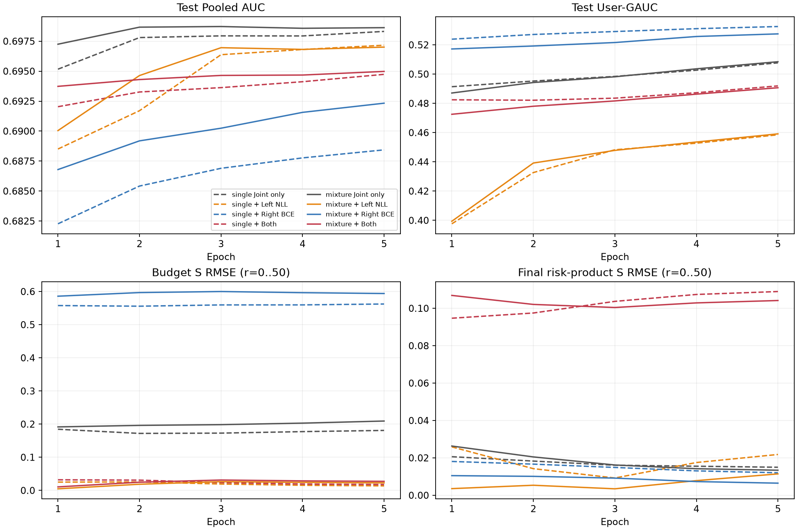
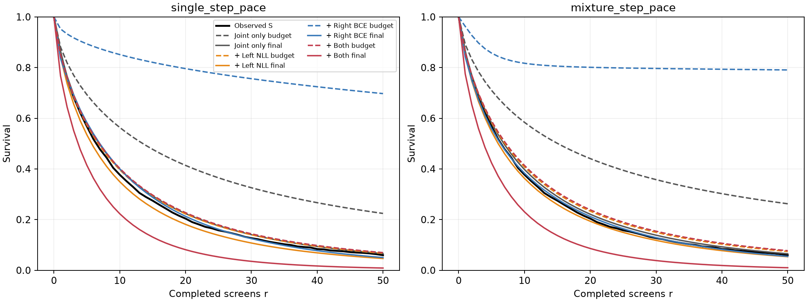

# 第21份：分支辅助Loss实验报告

KR v3、编码UID置0、单/混合威布尔+pace、3seed；连续训练5epoch，每轮末完整valid/test。新增18条轨迹、90次test和90次valid；6条无辅助对照直接复用，没有重复训练。

数据与Loss定义见[实验说明](实验说明.md)。辅助权重预先固定为1，不使用test选择权重或轮次。主表为固定第5轮末权重，均值±seed标准差；User-AUC是按请求数加权的用户内AUC。

## 核心发现

single_step_pace：仅左辅助使左塔S RMSE从0.1810变为0.0137；其AUC从0.698315变为0.697164，User-AUC从0.507694变为0.458494。双辅助的AUC=0.694735、LogLoss=0.239886、左塔RMSE=0.0177。

mixture_step_pace：仅左辅助使左塔S RMSE从0.2093变为0.0228；其AUC从0.698628变为0.697006，User-AUC从0.508456变为0.459137。双辅助的AUC=0.694979、LogLoss=0.238770、左塔RMSE=0.0274。

## 固定第5轮结果

| 结构 | Loss变体 | Pooled AUC | LogLoss | User-AUC | Intra-Step GAUC | 左塔会话NLL | 左塔S RMSE | 最终曲线RMSE |
| --- | --- | --- | --- | --- | --- | --- | --- | --- |
| single_step_pace | Joint only | 0.698315 ± 0.000311 | 0.230010 ± 0.000026 | 0.507694 ± 0.001657 | 0.638475 ± 0.000349 | 3.654986 ± 0.003994 | 0.180979 ± 0.001723 | 0.014982 ± 0.000564 |
| single_step_pace | + Left NLL | 0.697164 ± 0.000178 | 0.230531 ± 0.000088 | 0.458494 ± 0.001775 | 0.635279 ± 0.000598 | 3.452454 ± 0.001309 | 0.013680 ± 0.001604 | 0.021818 ± 0.001707 |
| single_step_pace | + Right BCE | 0.688436 ± 0.000147 | 0.231428 ± 0.000055 | 0.532522 ± 0.001650 | 0.633100 ± 0.000120 | 5.344637 ± 0.131286 | 0.562331 ± 0.006498 | 0.012037 ± 0.000820 |
| single_step_pace | + Both | 0.694735 ± 0.000121 | 0.239886 ± 0.000204 | 0.491936 ± 0.002504 | 0.634600 ± 0.000294 | 3.453139 ± 0.001628 | 0.017686 ± 0.002028 | 0.108971 ± 0.001244 |
| mixture_step_pace | Joint only | 0.698628 ± 0.000676 | 0.229961 ± 0.000136 | 0.508456 ± 0.001560 | 0.640428 ± 0.000863 | 3.713107 ± 0.011949 | 0.209276 ± 0.004367 | 0.013395 ± 0.000593 |
| mixture_step_pace | + Left NLL | 0.697006 ± 0.000674 | 0.230493 ± 0.000152 | 0.459137 ± 0.003813 | 0.634752 ± 0.000837 | 3.456663 ± 0.002127 | 0.022761 ± 0.002475 | 0.011431 ± 0.001776 |
| mixture_step_pace | + Right BCE | 0.692329 ± 0.000650 | 0.230883 ± 0.000107 | 0.527499 ± 0.001020 | 0.634913 ± 0.000820 | 7.640005 ± 0.139736 | 0.593945 ± 0.006506 | 0.006475 ± 0.000185 |
| mixture_step_pace | + Both | 0.694979 ± 0.000405 | 0.238770 ± 0.000295 | 0.490678 ± 0.001867 | 0.634876 ± 0.000621 | 3.458196 ± 0.002648 | 0.027354 ± 0.002799 | 0.104163 ± 0.001539 |

左塔NLL按3,281场完整test会话各计一次；两个曲线RMSE都在r=0..50评估。左塔曲线是全体首屏预算分布的平均S；最终曲线是已观察风险集内平均继续概率的连乘，两者不是同一预测对象。

## 相对旧联合训练的第5轮配对变化

| 结构 | 变体 | ΔAUC均值 | ΔUser-AUC均值 | Δ左塔NLL均值 | Δ左塔RMSE均值 | 三seed的ΔAUC |
| --- | --- | --- | --- | --- | --- | --- |
| single_step_pace | + Left NLL | -0.001151 | -0.049200 | -0.202532 | -0.167299 | -0.001200, -0.001256, -0.000997 |
| single_step_pace | + Right BCE | -0.009879 | +0.024828 | +1.689652 | +0.381352 | -0.010139, -0.010148, -0.009351 |
| single_step_pace | + Both | -0.003580 | -0.015758 | -0.201847 | -0.163294 | -0.003609, -0.003814, -0.003318 |
| mixture_step_pace | + Left NLL | -0.001622 | -0.049319 | -0.256444 | -0.186515 | -0.000399, -0.003017, -0.001451 |
| mixture_step_pace | + Right BCE | -0.006299 | +0.019043 | +3.926898 | +0.384669 | -0.006519, -0.006843, -0.005535 |
| mixture_step_pace | + Both | -0.003649 | -0.017778 | -0.254912 | -0.181922 | -0.002710, -0.004794, -0.003443 |

## 分支概率诊断（第5轮，三seed均值）

| 结构 | 变体 | 平均gamma | 平均stay | gamma独立BCE | stay独立BCE |
| --- | --- | --- | --- | --- | --- |
| single_step_pace | Joint only | 0.962312 | 0.972277 | 0.245245 | 0.265431 |
| single_step_pace | + Left NLL | 0.934897 | 0.992173 | 0.231656 | 0.450104 |
| single_step_pace | + Right BCE | 0.990068 | 0.941232 | 0.357693 | 0.234077 |
| single_step_pace | + Both | 0.935932 | 0.954337 | 0.231702 | 0.238366 |
| mixture_step_pace | Joint only | 0.965452 | 0.968908 | 0.249145 | 0.257169 |
| mixture_step_pace | + Left NLL | 0.937291 | 0.992794 | 0.231938 | 0.453502 |
| mixture_step_pace | + Right BCE | 0.989711 | 0.941201 | 0.486823 | 0.234072 |
| mixture_step_pace | + Both | 0.938396 | 0.954685 | 0.232041 | 0.238526 |

这四列均按test请求汇总，单独BCE用1e-6概率截断，仅作预测诊断，不混同按场NLL。训练日志中的左项关闭时记0，表中的离散NLL始终独立计算，不将“未开启”误认作完美拟合。

## 每轮完整test均值

| 结构 | 变体 | epoch | AUC | LogLoss | User-AUC | 左塔NLL | 左塔S RMSE |
| --- | --- | --- | --- | --- | --- | --- | --- |
| single_step_pace | Joint only | 1 | 0.695165 | 0.230626 | 0.491374 | 3.658265 | 0.184545 |
| single_step_pace | Joint only | 2 | 0.697802 | 0.230110 | 0.495255 | 3.634339 | 0.171951 |
| single_step_pace | Joint only | 3 | 0.697944 | 0.230044 | 0.498422 | 3.638276 | 0.172839 |
| single_step_pace | Joint only | 4 | 0.697938 | 0.230042 | 0.502665 | 3.648022 | 0.177364 |
| single_step_pace | Joint only | 5 | 0.698315 | 0.230010 | 0.507694 | 3.654986 | 0.180979 |
| single_step_pace | + Left NLL | 1 | 0.688506 | 0.231993 | 0.397640 | 3.457613 | 0.025082 |
| single_step_pace | + Left NLL | 2 | 0.691701 | 0.231371 | 0.432677 | 3.457074 | 0.025538 |
| single_step_pace | + Left NLL | 3 | 0.696374 | 0.230516 | 0.448259 | 3.454788 | 0.019277 |
| single_step_pace | + Left NLL | 4 | 0.696807 | 0.230511 | 0.452766 | 3.453379 | 0.015420 |
| single_step_pace | + Left NLL | 5 | 0.697164 | 0.230531 | 0.458494 | 3.452454 | 0.013680 |
| single_step_pace | + Right BCE | 1 | 0.682270 | 0.232547 | 0.523871 | 4.848661 | 0.557631 |
| single_step_pace | + Right BCE | 2 | 0.685418 | 0.231872 | 0.527093 | 4.933205 | 0.555718 |
| single_step_pace | + Right BCE | 3 | 0.686898 | 0.231648 | 0.529109 | 5.092801 | 0.559575 |
| single_step_pace | + Right BCE | 4 | 0.687766 | 0.231524 | 0.531058 | 5.206506 | 0.559661 |
| single_step_pace | + Right BCE | 5 | 0.688436 | 0.231428 | 0.532522 | 5.344637 | 0.562331 |
| single_step_pace | + Both | 1 | 0.692036 | 0.238110 | 0.482438 | 3.460131 | 0.032026 |
| single_step_pace | + Both | 2 | 0.693263 | 0.238008 | 0.482126 | 3.459081 | 0.031019 |
| single_step_pace | + Both | 3 | 0.693627 | 0.239007 | 0.483544 | 3.455946 | 0.023539 |
| single_step_pace | + Both | 4 | 0.694120 | 0.239656 | 0.487265 | 3.454215 | 0.019296 |
| single_step_pace | + Both | 5 | 0.694735 | 0.239886 | 0.491936 | 3.453139 | 0.017686 |
| mixture_step_pace | Joint only | 1 | 0.697249 | 0.230414 | 0.487065 | 3.669566 | 0.191598 |
| mixture_step_pace | Joint only | 2 | 0.698670 | 0.230010 | 0.494243 | 3.679065 | 0.196179 |
| mixture_step_pace | Joint only | 3 | 0.698722 | 0.229950 | 0.498163 | 3.687251 | 0.198405 |
| mixture_step_pace | Joint only | 4 | 0.698576 | 0.229973 | 0.503610 | 3.698981 | 0.202954 |
| mixture_step_pace | Joint only | 5 | 0.698628 | 0.229961 | 0.508456 | 3.713107 | 0.209276 |
| mixture_step_pace | + Left NLL | 1 | 0.690043 | 0.231508 | 0.399382 | 3.450394 | 0.004860 |
| mixture_step_pace | + Left NLL | 2 | 0.694635 | 0.230784 | 0.439186 | 3.452550 | 0.018654 |
| mixture_step_pace | + Left NLL | 3 | 0.696957 | 0.230352 | 0.447842 | 3.455395 | 0.026467 |
| mixture_step_pace | + Left NLL | 4 | 0.696816 | 0.230463 | 0.453564 | 3.456924 | 0.024354 |
| mixture_step_pace | + Left NLL | 5 | 0.697006 | 0.230493 | 0.459137 | 3.456663 | 0.022761 |
| mixture_step_pace | + Right BCE | 1 | 0.686794 | 0.231862 | 0.517184 | 5.494882 | 0.585886 |
| mixture_step_pace | + Right BCE | 2 | 0.689187 | 0.231364 | 0.519213 | 6.230871 | 0.596824 |
| mixture_step_pace | + Right BCE | 3 | 0.690243 | 0.231159 | 0.521584 | 7.066697 | 0.599947 |
| mixture_step_pace | + Right BCE | 4 | 0.691564 | 0.230964 | 0.525710 | 7.395912 | 0.596515 |
| mixture_step_pace | + Right BCE | 5 | 0.692329 | 0.230883 | 0.527499 | 7.640005 | 0.593945 |
| mixture_step_pace | + Both | 1 | 0.693733 | 0.239852 | 0.472524 | 3.450815 | 0.010643 |
| mixture_step_pace | + Both | 2 | 0.694301 | 0.238518 | 0.478023 | 3.454521 | 0.024789 |
| mixture_step_pace | + Both | 3 | 0.694645 | 0.238044 | 0.481654 | 3.457444 | 0.031359 |
| mixture_step_pace | + Both | 4 | 0.694677 | 0.238532 | 0.486286 | 3.458430 | 0.028789 |
| mixture_step_pace | + Both | 5 | 0.694979 | 0.238770 | 0.490678 | 3.458196 | 0.027354 |

## 如何解释这次实验

左塔离散NLL拟合的是观测到的总停止长度，不是单独标注的潜在时间预算。右塔独立BCE也使用总继续标签，不构成满意度监督。若两支各自逼近总继续概率p，乘积将趋向p²，因此三个目标存在取舍；第21份承诺“曲线完全贴合且AUC不下降”没有数学保证。

按场NLL等于每场one-hot KL。个性化Q_s下，它一般不等于先平均预测分布再对组直方图算KL；后者会留下更多个体层面的自由度。本次没有运行分组KL，没有使用test经验直方图作为训练目标，也没有把NLL误写成已计算的全局KL数值。

这是一组固定辅助权重下的对照，不穷尽弱正则、分组分布监督或其他标签的可能性。不依据本次test曲线追加调权。预算拟合与联合判别应分别汇报，不能把其中一个指标提升当作另外一个也必然提升。

量级也不能忽略：训练会话NLL约3.5、请求BCE约0.22。由于本次左项按场、主项按请求归一化，权重1不是等梯度强度；完整会话的逐屏gamma BCE求和等于单场NLL，故按场NLL均值与按请求gamma BCE均值相差训练平均屏数15.7427倍。终屏计一次避免把整场NLL在每屏重复计算；与按请求gamma BCE相比，两种归一化仅差全局系数，不能把同名权重1混为一谈。

若后续采用左停止监督，应把该分支明确描述成观测总停止分布预测；若仍要解释为纯预算，需要额外的监督或可检验识别假设。相同继续标签的右BCE不能替代CTR/满意度标签，也不能据此解决第16份组件语义的负结果。

v3沿用完整会话依赖的分屏起点、屏末elapsed和pace；结论仅针对当前离线协议。没有新增在线或因果预算识别证据。

## 数据、实现与核查证据

train为2022-04-08至05-06的1,721,745请求/109,368会话，valid 05-07为57,872请求/3,822会话，test 05-08为48,898请求/3,281会话、855用户。User-AUC沿用823个有双类别用户、48,855请求；其他用户不参与该项，不影响Pooled AUC。

18条新轨迹共有参数初始化hash、优化器参数组、物理请求顺序均与同seed旧对照完全一致。所有54特征及处理均未更改，仅编码UID沿用置0。每轮421更新，5轮2105更新，轮间不重置Adam、不恢复best。预算lr=0.005、其他lr=0.001、batch4096、clip10、普通权重decay1e-6、embedding/bias/1D为0。

- [训练日志](../../runs/plan21_auxiliary/logs/train.log) · [配置](../../runs/plan21_auxiliary/config.json) · [覆盖审计](../../runs/plan21_auxiliary/coverage.json)
- [全部指标](../../runs/plan21_auxiliary/analysis_metrics.parquet) · [完整曲线](../../runs/plan21_auxiliary/analysis_curves.parquet) · [训练Loss分项](../../runs/plan21_auxiliary/analysis_training_losses.parquet)
- [checkpoint、指标与NumPy独立公式审计](../../runs/plan21_auxiliary/analysis_audit.json)
- [新模型](../../pipeline/auxiliary_exit_model.py) · [训练入口](../../pipeline/run_auxiliary_exit.py) · [分析入口](../../pipeline/report_auxiliary_exit.py) · [专项测试](../../tests/test_auxiliary_exit.py)

复现：仓库根目录先运行`uv run python -m workspace.kr_time_budget.pipeline.run_auxiliary_exit --output 新目录`，再用本脚本`--run 新目录`读取；旧结果目录不能覆盖。仅重新生成报告使用`--report-only`。

同期已有UID置0 Fusion固定第5轮参考：auc=0.696619, logloss=0.230665, user_auc=0.493984, intra_step_gauc=0.636878。这组参考来自第18份已有训练，不计入本次新增轨迹，也不以其test指标选择本次超参。
