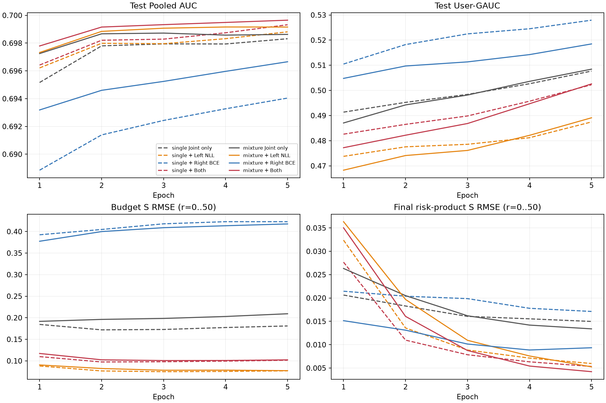
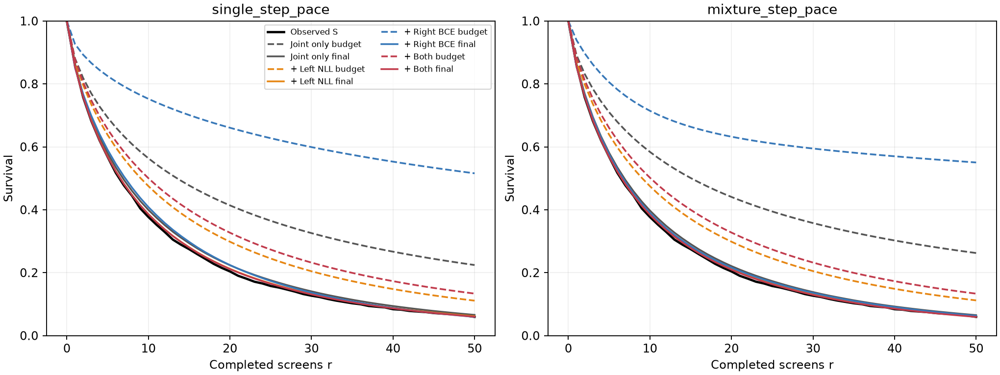

# 第21份补充：弱辅助Loss复验

**辅助合计每步最多为主Loss的10%，每项有效系数也≤0.1。** 主Loss保持原乘积BCE，不改变forward。旧权重1实验保留；本报告是按用户要求降低强度后的新实验。

完整定义见[弱辅助实验说明](弱辅助实验说明.md)。沿用KR v3、编码UID置0、单/混合+pace、3seed，每轮末测完整valid/test，连续5轮，每条2105次更新。新增18条训练轨迹、90次完整test；旧无辅助和旧强辅助直接复用。

## 核心结果

single_step_pace双辅助：AUC=0.699322（无辅助0.698315，旧强辅助0.694735）；User-AUC=0.502258（无辅助0.507694，旧强辅助0.491936）。左塔S RMSE由无辅助0.1810变为0.1016，最终曲线RMSE由0.0150变为0.0053。

mixture_step_pace双辅助：AUC=0.699652（无辅助0.698628，旧强辅助0.694979）；User-AUC=0.502597（无辅助0.508456，旧强辅助0.490678）。左塔S RMSE由无辅助0.2093变为0.1024，最终曲线RMSE由0.0134变为0.0042。

## 固定第5轮完整test结果

| 结构 | 变体 | Pooled AUC | LogLoss | User-AUC | Intra-Step GAUC | 左塔会话NLL | 左塔S RMSE | 最终曲线RMSE |
| --- | --- | --- | --- | --- | --- | --- | --- | --- |
| single_step_pace | Joint only | 0.698315 ± 0.000311 | 0.230010 ± 0.000026 | 0.507694 ± 0.001657 | 0.638475 ± 0.000349 | 3.654986 ± 0.003994 | 0.180979 ± 0.001723 | 0.014982 ± 0.000564 |
| single_step_pace | + Left NLL | 0.698812 ± 0.000646 | 0.229851 ± 0.000097 | 0.487468 ± 0.001761 | 0.637386 ± 0.000535 | 3.494153 ± 0.002834 | 0.076939 ± 0.000753 | 0.005974 ± 0.000422 |
| single_step_pace | + Right BCE | 0.694042 ± 0.000238 | 0.230668 ± 0.000054 | 0.527935 ± 0.001672 | 0.637238 ± 0.000211 | 4.368815 ± 0.005668 | 0.422727 ± 0.005235 | 0.017120 ± 0.002089 |
| single_step_pace | + Both | 0.699322 ± 0.000586 | 0.229745 ± 0.000083 | 0.502258 ± 0.002056 | 0.638843 ± 0.000366 | 3.520810 ± 0.004735 | 0.101562 ± 0.002611 | 0.005346 ± 0.001259 |
| mixture_step_pace | Joint only | 0.698628 ± 0.000676 | 0.229961 ± 0.000136 | 0.508456 ± 0.001560 | 0.640428 ± 0.000863 | 3.713107 ± 0.011949 | 0.209276 ± 0.004367 | 0.013395 ± 0.000593 |
| mixture_step_pace | + Left NLL | 0.699157 ± 0.000471 | 0.229857 ± 0.000080 | 0.489120 ± 0.001889 | 0.638243 ± 0.001040 | 3.495241 ± 0.000719 | 0.077316 ± 0.001898 | 0.005256 ± 0.002779 |
| mixture_step_pace | + Right BCE | 0.696658 ± 0.000328 | 0.230281 ± 0.000042 | 0.518490 ± 0.002234 | 0.638720 ± 0.000871 | 4.390450 ± 0.023385 | 0.417561 ± 0.003612 | 0.009349 ± 0.000544 |
| mixture_step_pace | + Both | 0.699652 ± 0.000447 | 0.229739 ± 0.000087 | 0.502597 ± 0.001124 | 0.639876 ± 0.000920 | 3.521175 ± 0.002572 | 0.102379 ± 0.001837 | 0.004226 ± 0.001027 |

均值±seed标准差，固定第5轮末权重；未以test选点。User-AUC是请求数加权的用户内AUC，排除单类别用户后为823用户、48,855请求。Pooled AUC使用全部48,898请求。

## 相同seed下的变化

| 结构 | 变体 | ΔAUC vs无辅助 | ΔUser-AUC vs无辅助 | ΔLogLoss vs无辅助 | ΔAUC vs旧强辅助 | ΔUser-AUC vs旧强辅助 |
| --- | --- | --- | --- | --- | --- | --- |
| single_step_pace | + Left NLL | +0.000497 | -0.020227 | -0.000160 | +0.001648 | +0.028973 |
| single_step_pace | + Right BCE | -0.004273 | +0.020241 | +0.000658 | +0.005606 | -0.004587 |
| single_step_pace | + Both | +0.001007 | -0.005436 | -0.000265 | +0.004588 | +0.010322 |
| mixture_step_pace | + Left NLL | +0.000529 | -0.019336 | -0.000104 | +0.002151 | +0.029983 |
| mixture_step_pace | + Right BCE | -0.001970 | +0.010034 | +0.000320 | +0.004329 | -0.009009 |
| mixture_step_pace | + Both | +0.001024 | -0.005859 | -0.000222 | +0.004672 | +0.011919 |

## 每步Loss上限核验

原始辅助系数a,b从1降到0.1；再令`c=min(1,0.1*J.detach()/A.detach())`，`A=a*N+b*C`。最终优化`J+c*A`。c停止梯度，主任务梯度系数仍为1；两个辅助项共用合计上限。

| 结构 | 变体 | epoch5主Loss均值 | epoch5加权辅助均值 | 左项有效系数均值 | 右项有效系数均值 | 全5轮最大辅助/主比 |
| --- | --- | --- | --- | --- | --- | --- |
| single_step_pace | + Left NLL | 0.218928 | 0.021893 | 0.006279 | 0.000000 | 0.100000000000 |
| single_step_pace | + Right BCE | 0.219307 | 0.021931 | 0.000000 | 0.096952 | 0.100000000000 |
| single_step_pace | + Both | 0.218902 | 0.021890 | 0.005789 | 0.005789 | 0.100000000000 |
| mixture_step_pace | + Left NLL | 0.218874 | 0.021887 | 0.006274 | 0.000000 | 0.100000000000 |
| mixture_step_pace | + Right BCE | 0.219005 | 0.021900 | 0.000000 | 0.097121 | 0.100000000000 |
| mixture_step_pace | + Both | 0.218825 | 0.021883 | 0.005789 | 0.005789 | 0.100000000000 |

每场NLL与每请求BCE的数值尺度不同，左项实际有效系数通常远小于0.1，这是执行“辅助合计最多主Loss10%”的结果。合计上限相同时，左/右/双辅助分配给两个分支的比例仍不同。每步占比、系数、主Loss与原始辅助值全部留档，并用独立NumPy公式重算。

## 固定checkpoint梯度诊断

固定第5轮模型，在第一个4096行训练batch上只计算梯度，不执行optimizer.step。下表为三seed均值；比例是裁剪前的辅助梯度范数/主任务梯度范数，不能与Loss数值占比混淆。

| 结构 | 变体 | 全模型梯度比 | 预算分支梯度比 | 内容分支梯度比 | 全模型梯度夹角余弦 |
| --- | --- | --- | --- | --- | --- |
| single_step_pace | + Left NLL | 0.126028 | 0.147835 | 0.000000 | -0.130895 |
| single_step_pace | + Right BCE | 0.454670 | 0.000000 | 0.553581 | 0.130537 |
| single_step_pace | + Both | 0.211328 | 0.206379 | 0.232622 | -0.266115 |
| mixture_step_pace | + Left NLL | 0.125196 | 0.150456 | 0.000000 | -0.246484 |
| mixture_step_pace | + Right BCE | 0.454201 | 0.000000 | 0.550054 | 0.094641 |
| mixture_step_pace | + Both | 0.199870 | 0.192405 | 0.227798 | -0.305058 |

该诊断是一个固定训练batch，不代表整轮梯度统计；训练仍使用原clip=10。10%的数值上限本身不能承诺梯度范数≤10%。

## 每轮完整test均值

| 结构 | 变体 | epoch | AUC | LogLoss | User-AUC | 左塔NLL | 左塔S RMSE | 最终曲线RMSE |
| --- | --- | --- | --- | --- | --- | --- | --- | --- |
| single_step_pace | Joint only | 1 | 0.695165 | 0.230626 | 0.491374 | 3.658265 | 0.184545 | 0.020630 |
| single_step_pace | Joint only | 2 | 0.697802 | 0.230110 | 0.495255 | 3.634339 | 0.171951 | 0.018285 |
| single_step_pace | Joint only | 3 | 0.697944 | 0.230044 | 0.498422 | 3.638276 | 0.172839 | 0.016064 |
| single_step_pace | Joint only | 4 | 0.697938 | 0.230042 | 0.502665 | 3.648022 | 0.177364 | 0.015540 |
| single_step_pace | Joint only | 5 | 0.698315 | 0.230010 | 0.507694 | 3.654986 | 0.180979 | 0.014982 |
| single_step_pace | + Left NLL | 1 | 0.696214 | 0.230732 | 0.473791 | 3.506444 | 0.088153 | 0.032380 |
| single_step_pace | + Left NLL | 2 | 0.697986 | 0.230050 | 0.477578 | 3.493262 | 0.076670 | 0.013586 |
| single_step_pace | + Left NLL | 3 | 0.697956 | 0.229995 | 0.478580 | 3.492356 | 0.074958 | 0.008861 |
| single_step_pace | + Left NLL | 4 | 0.698321 | 0.229924 | 0.481201 | 3.493029 | 0.075557 | 0.007137 |
| single_step_pace | + Left NLL | 5 | 0.698812 | 0.229851 | 0.487468 | 3.494153 | 0.076939 | 0.005974 |
| single_step_pace | + Right BCE | 1 | 0.688851 | 0.231554 | 0.510498 | 4.154316 | 0.392426 | 0.021452 |
| single_step_pace | + Right BCE | 2 | 0.691390 | 0.231071 | 0.518231 | 4.237036 | 0.404711 | 0.020383 |
| single_step_pace | + Right BCE | 3 | 0.692432 | 0.230937 | 0.522485 | 4.314387 | 0.417838 | 0.019865 |
| single_step_pace | + Right BCE | 4 | 0.693271 | 0.230793 | 0.524522 | 4.349255 | 0.422798 | 0.017795 |
| single_step_pace | + Right BCE | 5 | 0.694042 | 0.230668 | 0.527935 | 4.368815 | 0.422727 | 0.017120 |
| single_step_pace | + Both | 1 | 0.696421 | 0.230570 | 0.482615 | 3.532147 | 0.109885 | 0.027668 |
| single_step_pace | + Both | 2 | 0.698205 | 0.229973 | 0.486506 | 3.515705 | 0.097440 | 0.010980 |
| single_step_pace | + Both | 3 | 0.698286 | 0.229914 | 0.489855 | 3.517012 | 0.098029 | 0.007851 |
| single_step_pace | + Both | 4 | 0.698744 | 0.229825 | 0.495723 | 3.518690 | 0.099431 | 0.006334 |
| single_step_pace | + Both | 5 | 0.699322 | 0.229745 | 0.502258 | 3.520810 | 0.101562 | 0.005346 |
| mixture_step_pace | Joint only | 1 | 0.697249 | 0.230414 | 0.487065 | 3.669566 | 0.191598 | 0.026326 |
| mixture_step_pace | Joint only | 2 | 0.698670 | 0.230010 | 0.494243 | 3.679065 | 0.196179 | 0.020510 |
| mixture_step_pace | Joint only | 3 | 0.698722 | 0.229950 | 0.498163 | 3.687251 | 0.198405 | 0.016196 |
| mixture_step_pace | Joint only | 4 | 0.698576 | 0.229973 | 0.503610 | 3.698981 | 0.202954 | 0.014201 |
| mixture_step_pace | Joint only | 5 | 0.698628 | 0.229961 | 0.508456 | 3.713107 | 0.209276 | 0.013395 |
| mixture_step_pace | + Left NLL | 1 | 0.697325 | 0.230664 | 0.468293 | 3.506941 | 0.090588 | 0.036341 |
| mixture_step_pace | + Left NLL | 2 | 0.698844 | 0.229985 | 0.474114 | 3.496575 | 0.082326 | 0.019693 |
| mixture_step_pace | + Left NLL | 3 | 0.699074 | 0.229838 | 0.476145 | 3.493013 | 0.078296 | 0.010941 |
| mixture_step_pace | + Left NLL | 4 | 0.699161 | 0.229814 | 0.482152 | 3.494388 | 0.078484 | 0.007586 |
| mixture_step_pace | + Left NLL | 5 | 0.699157 | 0.229857 | 0.489120 | 3.495241 | 0.077316 | 0.005256 |
| mixture_step_pace | + Right BCE | 1 | 0.693187 | 0.230858 | 0.504788 | 4.106823 | 0.377396 | 0.015144 |
| mixture_step_pace | + Right BCE | 2 | 0.694601 | 0.230576 | 0.509716 | 4.200701 | 0.399828 | 0.013113 |
| mixture_step_pace | + Right BCE | 3 | 0.695243 | 0.230519 | 0.511348 | 4.272386 | 0.408879 | 0.010146 |
| mixture_step_pace | + Right BCE | 4 | 0.695966 | 0.230401 | 0.514246 | 4.330222 | 0.413376 | 0.008867 |
| mixture_step_pace | + Right BCE | 5 | 0.696658 | 0.230281 | 0.518490 | 4.390450 | 0.417561 | 0.009349 |
| mixture_step_pace | + Both | 1 | 0.697794 | 0.230529 | 0.477230 | 3.539466 | 0.117184 | 0.035032 |
| mixture_step_pace | + Both | 2 | 0.699156 | 0.229853 | 0.482195 | 3.518772 | 0.102457 | 0.016065 |
| mixture_step_pace | + Both | 3 | 0.699330 | 0.229758 | 0.486846 | 3.517346 | 0.100757 | 0.008755 |
| mixture_step_pace | + Both | 4 | 0.699488 | 0.229736 | 0.494707 | 3.518421 | 0.100929 | 0.005431 |
| mixture_step_pace | + Both | 5 | 0.699652 | 0.229739 | 0.502597 | 3.521175 | 0.102379 | 0.004226 |

## 结论边界和证据

这次只降低辅助强度，未搜索多个上限；不以test结果进一步调节。三seed均值和波动不替代显著性检验。左塔仍拟合观测总停止长度，右塔仍使用总继续标签；强度变化不构成内容满意度监督或潜在预算识别。

左塔S曲线为所有首屏预算分布的平均；最终曲线为已观察风险集平均继续概率的连乘。RMSE都在r=0..50衡量，二者预测对象不同。KR v3沿用完整会话依赖的分屏和屏末pace，不声称屏前在线可用。

数据：train 2022-04-08至05-06的1,721,745请求/109,368场，valid 05-07的57,872请求/3,822场，test 05-08的48,898请求/3,281场。初始化hash、optimizer分组、物理请求顺序与已有对照一致，编码UID置0、其他输入保持原样。AdamW预算lr=.005、其他lr=.001、普通权重decay1e-6、embedding/bias/1D为0，batch4096、clip10，无冻结、预热、scheduler或EMA。

- [训练日志](../../runs/plan21_auxiliary_cap10/logs/train.log) · [配置](../../runs/plan21_auxiliary_cap10/config.json) · [测试日志](../../runs/plan21_auxiliary_cap10/logs/tests.log)
- [指标与checkpoint审计](../../runs/plan21_auxiliary_cap10/analysis_audit.json) · [Loss上限审计](../../runs/plan21_auxiliary_cap10/loss_cap_audit.json)
- [全部指标](../../runs/plan21_auxiliary_cap10/analysis_metrics.parquet) · [每步Loss](../../runs/plan21_auxiliary_cap10/loss_steps_all.parquet) · [梯度诊断](../../runs/plan21_auxiliary_cap10/gradient_diagnostic.parquet)
- [弱辅助模型](../../pipeline/limited_auxiliary_exit.py) · [训练入口](../../pipeline/run_limited_auxiliary.py) · [报告入口](../../pipeline/report_limited_auxiliary.py)
- [旧权重1报告](实验报告.md) · [弱辅助实验说明](弱辅助实验说明.md)
