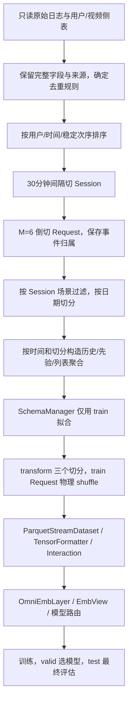

# KR 数据集特征与 rosen 流水线决策报告

> 执行更新：已按第4份方案完成v3数据与四模型全量训练；本文原有待明确项已按实现口径处理，见 [v3执行报告](../6/执行报告.md) 和 [复现说明](../6/复现说明.md)。以下正文保留为执行前的决策依据。

日期：2026-11-16。用途：交给协作者核对数据集构建方案，作为下一版预处理和 Schema 实现的依据。

**当前主方案以 [Argon-plans/4.特征集敲定.md](../../../../Argon-plans/4.特征集敲定.md) 为准。** 本报告梳理原始数据、当前实现差距、rosen 可复用部分，以及该方案仍需明确的字段定义。本文没有执行新一轮数据构建或训练；文中的建议结构尚未落地。

## 1. 需要作出的决定

本次应先确定“什么信息在什么时刻成为一条 Request 的特征”，再写 Schema 和训练模型。**新增业务特征大部分确实应该在数据集预处理阶段考虑并生成，但词表、归一化和总体统计不能不分切分地提前拟合。**

应分成三层：

| 层次 | 做什么 | 典型例子 |
| --- | --- | --- |
| 原始信息保留、结构构建 | 保留日志字段和来源；按顺序切 Session、倒切 Request；保留事件归属 | `is_click`、`tag`、`request_id → event_id` |
| 任务特征派生 | 按明确观察时刻统计历史，聚合当屏内容；按切分和时间边界构建先验 | 上一屏点击数、历史标签、物品历史 CTR |
| Schema 与模型 | train-fit 词表/数值变换；编码、padding、Embedding、特征路由和学习 | `MultiSparseSetting`、`OmniEmbLayer`、预算参数网络 |

第 4 份方案已经确定：按日期切分、用户画像与用户 ID、聚合多标签、二值历史反馈、不使用裸视频 ID Embedding，以及预算参数与物理时钟分开输入。无需重新讨论一整套无边界候选特征。优先解决第 6 节列出的少量定义问题，然后实现。

## 2. 我们实际拥有什么数据

以下是本地文件的实测值，来源为 `datasource/KuaiRand/KuaiRand-1K/data/`。字段语义参考随数据提供的 [README](../../../../datasource/KuaiRand/KuaiRand-1K/README.md)。详细字段、类型、缺失数和去重值数量保存在 [inventory.json](../../analysis/kr-feature-decision/inventory.json)，审计输出见 [inventory.log](../../analysis/kr-feature-decision/inventory.log)。

### 2.1 文件与规模

| 文件 | 本地规模 | 字段数 | 用途 |
| --- | ---: | ---: | --- |
| `log_standard_4_08_to_4_21_1k.csv` | 5,055,984 行 | 19 | 前半段标准行为日志 |
| `log_standard_4_22_to_5_08_1k.csv` | 6,657,061 行 | 19 | 后半段标准行为日志 |
| `log_random_4_22_to_5_08_1k.csv` | 43,028 行 | 19 | 随机探索日志 |
| `user_features_1k.csv` | 1,000 行 | 31 | 用户画像 |
| `video_features_basic_1k.csv` | 4,371,868 行，视频 ID 唯一 | 12 | 视频基础属性 |
| `video_features_statistic_1k.csv` | 约 3.37 GB；本次仅核对 Schema，未全表计数 | 52 | 全月统计侧表 |

三份日志合计 **11,756,073 行**。视频基础表的基数是整张侧表的基数，不等于最终 Request 覆盖的视频数。

### 2.2 用户特征：31 列

| 字段组 | 原始情况 | 第 4 份方案 |
| --- | --- | --- |
| `user_id` | 1,000 个不同用户，无空值 | Sparse，dim=16、min_freq=10；保留 OOV 能力 |
| `user_active_degree` | 7 类，无空值；其中 full_active 640 人、high_active 233 人 | Sparse，dim=8、min_freq=10 |
| `is_live_streamer`、`is_video_author` | 各 2 个取值，无空值 | Sparse，dim=8、min_freq=10 |
| `is_lowactive_period` | 本地只有一个取值 | 不进入模型；原始信息仍保留 |
| `follow_user_num`、`fans_user_num`、`friend_user_num`、`register_days` | 连续计数与天数，无空值 | 新方案使用对应 `*_range`；不再沿用当前 v2 的连续输入 |
| 上述四个 `*_range` | 分别为 8、8、7、7 个不同取值 | 全部 Sparse，dim=8、min_freq=10 |
| `onehot_feat0..17` | 脱敏字段；名字不表示都应该当连续数。`onehot_feat4` 及 `12..17` 各有 33 个空值 | 全部 Sparse，dim=8、min_freq=10；明确缺失类别 |

原始计数和分桶都可以保留在未编码侧表中，模型字段按已敲定清单选择。不要因为当前选择分桶，就在基础数据中删除原始计数。画像表没有逐事件快照时间：使用它属于沿用该数据集的静态画像设定，不能据此声称已证明画像在每个历史时刻都可获得。

### 2.3 视频基础特征：12 列

| 字段 | 本地核对结果 | 新方案如何使用 |
| --- | --- | --- |
| `video_id` | 4,371,868 个唯一值 | 连接和统计键；不建裸 ID Embedding |
| `author_id` | 1,407,475 个不同值，无空值 | 当屏不同作者数；不新增作者 ID Embedding |
| `tag` | 137,484 行为空；整串有 1,189 个不同取值，**拆分后为 58 个 token** | 聚合为 `slate_tags`、`hist_tags`，交给 MultiSparse |
| `video_type` | 3 类，无空值 | 当屏 `slate_video_types`，MultiSparse |
| `music_type` | 59,952 行为空；含空值共 7 个不同取值 | 当屏 `slate_music_types`，MultiSparse；需缺失 token |
| `music_id` | 2,622,610 个不同值，无空值 | 保留侧表，不进入本版模型 |
| `video_duration` | 573,057 行为空；数据说明单位为毫秒 | 本方案使用日志 `duration_ms` 聚合片长，不能混淆两个来源 |
| `upload_dt`、`upload_type` | 上传日期/类型；日期有 58 个空值 | 保留侧表，不在已敲定特征中 |
| `visible_status` | 有 5 个空值，数据说明是视频当前可见状态 | 保留侧表，不在已敲定特征中 |
| `server_width`、`server_height` | 各有 7 个空值 | 保留侧表，不在已敲定特征中 |

**多标签并非少量边缘情况：945,330 条视频有多个 tag；非空视频平均 1.230 个 tag，最多 5 个。** 当前将 `"20,43"` 当一个类别，会失去它与 `"20,67"` 共享 tag 20 的关系。第 4 份方案改用 MultiSparse 能纠正这个表示问题，但效果提升仍需实验验证。

### 2.4 行为日志：19 列

| 分组 | 原始字段 | 在本任务中的作用 |
| --- | --- | --- |
| 主键与时间 | `user_id`、`video_id`、`date`、`hourmin`、`time_ms` | 排序、切场、切分、连接侧表 |
| 播放与片长 | `play_time_ms`、`duration_ms` | 前者用于切场和屏末时钟；后者用于当屏平均物理片长 |
| 二值交互 | `is_click`、`long_view`、`is_like`、`is_follow`、`is_comment`、`is_forward`、`is_hate` | 历史满意度、历史筛选、点击/长播质量先验 |
| 场景与探索 | `tab`、`is_rand` | Session 场景、随机探索标记 |
| 其他行为 | `profile_stay_time`、`comment_stay_time`、`is_profile_enter` | 保留原始信息，不进入已敲定特征 |

`is_click` 是新方案必需字段，但**当前 Request 构建脚本没有读取它**。仅修改 Schema 无法补出点击历史，必须重建上游派生数据。

### 2.5 全月统计侧表的边界

`video_features_statistic_1k.csv` 包含曝光、播放、点赞、评论、关注、分享等全月平均统计。随数据 README 明确说明其统计跨全月、日期和场景。该表没有足够的逐时点信息来截取“某条 Request 之前的统计”。

因此，本版物品 CTR/长播率应从行为日志按时间构造，而不是直接接入这张全月侧表。它与日志中自行重算的 past-day prior 是两种不同数据来源。

## 3. 当前实现在哪里，缺什么

现有入口为 [build_requests.py](../../pipeline/build_requests.py)、[features_v2.py](../../pipeline/features_v2.py)、[time_budget_v2.py](../../pipeline/time_budget_v2.py)。现有数据在 `workspace/kr_time_budget/data/v1/` 和 `v2/`。

当前构造结果：投影字段去重后 11,661,828 条事件、147,066 个 Session；排除每个用户首尾 Session 及不足 6 条事件的 Session 后，留下 **118,041 个 Session、1,856,774 条 Request、1,000 个用户**。这些是旧协议产物规模，不能直接当作新日期切分、场景过滤后的规模。

| 项目 | 当前 v2 | 第 4 份方案要求的变化 |
| --- | --- | --- |
| 切分 | 5 折按用户分组，折内另留用户 valid | 按日期 train≤20220506、valid=20220507、test=20220508；跨日 Session 归属需明确 |
| 用户画像 | 连续人数/天数；`onehot_feat12..17` 当数值；无用户 ID Embedding | 使用用户 ID、原生分桶、全部脱敏字段 Sparse |
| 多标签 | 每条视频完整 tag 字符串作为类别；slate/history 分别为 6/12 长序列 | 拆成 token，聚合为 MultiSparse 标签袋 |
| 历史反馈 | 前屏播放量、完成率等；未读取 click | 改为点击、长播、正反馈、点踩统计；历史标签按点击/长播筛选 |
| 当屏类型 | 无视频类型、音乐类型 | 补 join 和聚合 |
| 物品先验 | comp/long_view/is_like，各 mean/min/max | 改为 CTR、longview 两项均值 |
| 片长 | 向量、总量，3～600 秒裁剪 | 平均分钟数；是否沿用裁剪需明确定义 |
| 历史可追溯性 | 保存截断历史、少数 prior 事件列 | 应保存完整事件与 Request 归属，便于重算特征 |
| 模型编码 | 存在直接访问 Embedding 表、硬编码维度的实现 | 通过 Schema 的计算接口和 EmbView 获取表示 |

当前去重使用选出的 15 个日志字段，不包含其余 4 个行为字段，因此只是“当前投影一致”的去重，不能称为完整原始行去重。补回 click 后应明确去重依据并记录新旧行数差异。

旧结果只能说明当前特征和协议下的结果。v2 的 Fusion User-GAUC 为 0.580714，相乘模型为 0.544476；它们采用全量五折用户切分、最多三个 epoch、全 valid 选择 checkpoint、完整 OOF 评估。训练口径、LogLoss 与日志见 [v2 执行报告](../历史归档/20261116_kr-time-budget-v2-report.md)，全日志为 `workspace/kr_time_budget/runs/exit_v2/run.log`。**这些结果不能归因成“缺少某个特征导致”，也不能直接与新日期切分结果比较。**

## 4. 按第 4 份方案整理的特征契约

方案标题写“36 个字段”，但按表格逐字段展开为 **54 个模型字段：B1=28、B2=8、B3=9、B4=9**。下面以具体字段清单为准，避免实现时按数字猜测。`y_continue`、主键、审计字段和固定 `delta=1` 不计入这 54 个字段。

### B1：用户画像与历史预算，28 个字段

| 字段 | 数量 | 编码/构造 |
| --- | ---: | --- |
| `user_id` | 1 | Sparse(16)，min_freq=10、OOV |
| `user_active_degree`、`is_live_streamer`、`is_video_author` | 3 | Sparse(8)，min_freq=10、OOV |
| `friend_user_num_range`、`register_days_range`、`follow_user_num_range`、`fans_user_num_range` | 4 | Sparse(8)，min_freq=10、OOV |
| `onehot_feat0..17` | 18 | Sparse(8)，min_freq=10、缺失/OOV 明确区分 |
| `user_hist_session_min`、`user_hist_req_cnt` | 2 | Float32；场均挂钟分钟数、场均 Request 数；log1p |

历史预算的可用时间见第 6 节。不能把“用户出现在 train”与“这个用户未来的会话已经可见”混为一谈。按日期切分也不保证每个评估用户都在 train 出现，需要报告实际用户交集与 OOV 比例。

### B2：开场情境与时钟，8 个字段

| 字段 | 数量 | 编码/构造 |
| --- | ---: | --- |
| `tab` | 1 | Sparse(8)，padding_zero=False；Session 场景，同时供分域评估 |
| `day_of_week`、`is_weekend`、`start_hour` | 3 | Sparse(8)；取 Session 开场时间 |
| `day_prev_sess_cnt`、`day_prev_elapsed_min` | 2 | Float32、log1p；开场前已完成场数与累计挂钟分钟数 |
| `elapsed_min` | 1 | Float32，原始分钟值进入生存公式，不做 log1p 后代入物理公式 |
| `req_idx` | 1 | Float32，本场第几屏，从 1 开始 |

沿用 Leader 的屏末时钟：

```text
elapsed_min = (本屏第6条 time_ms - 本场首条 time_ms
               + clip(本屏第6条 play_time_ms, 0, 300000)) / 60000
```

固定 `delta=1.0` 分钟是生存公式参数，不从片长推导。此任务是屏末继续预测，不能直接改称屏前候选列表打分。

### B3：前序消费历史，9 个字段

| 字段 | 数量 | 编码/构造 |
| --- | ---: | --- |
| `is_first_req` | 1 | Sparse(4) |
| `prev1_click_cnt`、`prev1_longview_cnt`、`prev1_pos_cnt` | 3 | Float32，上一屏点击/长播/正反馈视频数 |
| `sess_cum_click_rate`、`sess_cum_longview_rate`、`sess_cum_pos_rate`、`sess_cum_hate_cnt` | 4 | Float32，仅累计本屏之前的事件 |
| `hist_tags` | 1 | MultiSparse(16)，max_tag_len=15；前两屏点击或长播视频的 tag |

不再用中间视频播放时长生成 B3 满意度特征。空历史与存在历史但无 tag 应能区分；前缀余数是否参与历史，见第 6 节。

### B4：当屏列表，9 个字段

| 字段 | 数量 | 编码/构造 |
| --- | ---: | --- |
| `slate_tags` | 1 | MultiSparse(16)，max_tag_len=12，逗号拆分 |
| `slate_video_types`、`slate_music_types` | 2 | MultiSparse(8)，max_tag_len=6 |
| `slate_prior_ctr_mean`、`slate_prior_longview_mean` | 2 | Float32，6 个视频的历史平滑质量均值 |
| `slate_dur_mean_min` | 1 | Float32，日志 duration_ms 聚合为平均分钟数 |
| `slate_unique_tag_cnt`、`slate_unique_author_cnt` | 2 | Float32；tag 的定义需校准，作者按 ID 去重 |
| `slate_has_rand` | 1 | Sparse(4)，本屏是否存在 is_rand=1 |

这版使用聚合标签袋，不建 `video_id`、`author_id`、`music_id` Embedding。ID 仍需保留为连接、去重、统计和审计键；“不编码 ID”不意味着“删掉 ID”。

### 输入字段与塔内路由

四个对照模型接收同一字段集合。`FeatureSource` 描述字段来源，不自动等于 B1～B4，也不自动实现预算塔掩码。

- 预算参数网络：B1 + B2 的开场情境和开场前消费；不输入 `elapsed_min`、`req_idx`、B3、B4。
- 生存公式：单独输入未改变物理单位的 `elapsed_min` 与固定 delta。
- 内容网络：按方案输入全特征；若“elapsed 仅作为生存自变量”意指内容网络也不接收它，需要在实现前明确这条文字与“右塔全特征”的边界。

预算分支的参数和相关编码器在第二阶段冻结。固定参数时，S 对递增时间非增；**原始屏末时间公式自身可能回退**，当前 v2 已有记录，因此不能承诺按日志顺序 S 必然下降，也不应静默 cummax 改时钟。

## 5. rosen 流水线如何承接

### 5.1 正确的数据流顺序



不能在切场前过滤 tab 或打乱事件；那会改变相邻关系、Session 和标签。可在原始有序事件上生成结构后再聚合、落盘。Top 5 的选择依据和 Session 主场景定义要显式写入 manifest。

沿用的切场规则为：相邻事件满足 `next_time_ms - (time_ms + clip(play_time_ms,0,300000)) > 1800000` 时切新 Session。倒切 Request、首尾 Session 排除和不足一屏的余数处理，继续显式记录；日期切分不应偷偷修改这些规则。

### 5.2 建议保留的数据层

下面是建议逻辑结构，不要求每一层都复制一份完整宽表：

| 层 | 最少保留内容 | 原因 |
| --- | --- | --- |
| 原始/typed 事件 | 全部 19 列、source_file、source_row、稳定 event_id；保留原始与清洗值区别 | 新增反馈特征无需重新猜测去重和事件归属 |
| 用户/视频侧表 | 原始画像；原始 tag 与 token 列表；原始 ID | 与编码参数解耦，可复用 |
| Session | user_id、起止时间、开场情境、事件数、首尾观察边界 | 明确切分与历史可用时间 |
| Request | request_id、session_id、序号、首末事件、观察时刻、label | 定义任务样本 |
| Request 事件关系 | request_id、event_id、屏内位置；余数事件单独标识 | 可重算当屏与历史特征，不依赖已截断的标签串 |
| 切分后特征 | 54 字段、先验支持数/回退标记、切分与时间规则 | 模型输入和审计输入分开 |
| 编码数据 | train/valid/test parquet、feature_meta.json、manifest | 可直接训练和复现 |

普通实验只读 datasource，派生结果写新版本 `workspace/kr_time_budget/data/<新版本>/`；不覆盖 v1/v2。无损 canonical 转换有单独维护规则，本报告不安排改写 datasource。

### 5.3 已有组件能复用什么

| rosen 组件 | 负责什么 | 不负责什么 |
| --- | --- | --- |
| `KuaiRandDataset` | 原始数据路径入口；支持配置 datasource 根目录 | 不自动切场、构造 Request |
| `SparseEmbSetting` | 类别词表、频次截断、缺失/OOV、Embedding 定义 | 不决定类别是否在观察时刻可用 |
| `MultiSparseSetting` | 逗号拆分或列表输入、长度上限、padding、多 token 聚合 | 不决定历史窗口、去重规则、标签保留次序 |
| 数值 Setting | 按声明处理数值、生成 Tensor；MinMax 等参数应 train-fit | 不自动执行业务约定的 log1p 或时间单位转换 |
| `SchemaManager` | fit、transform、序列化 Schema、导出数据 | 不自动防止业务统计使用未来信息 |
| `ParquetStreamDataset` | 读取已编码 parquet，形成 batch | 不替代事件排序与样本构建 |
| `OmniEmbLayer` / `EmbView` | 调用字段计算逻辑，按字段/来源选择表示 | 不替代模型的预算/内容路由规则 |
| Trainer / Evaluator / EarlyStopper | 训练、评估、按 valid 选择模型 | 不自动保证自定义 predict 的概率语义 |

`MultiSparseSetting` 的原生聚合支持 sum/mean。若保留重复 token，sum 会体现重复次数；若希望集合语义，需在特征生成时明确去重。`max_tag_len` 会截断，不能只写一个长度而不约定保留策略。

当前方案用聚合 MultiSparse 即可，不需要为了复用框架新增逐视频嵌套序列。未来若研究顺序或逐视频内容，rosen 另有 `SequenceSetting(MultiSparseSetting)` 能表达视频序列与多 tag 的嵌套；那属于另一版数据和模型设计，不混入本次 54 字段。

`ParquetStreamDataset` 自身产出 batch，外层 `DataLoader` 必须用 `batch_size=None`。模型应通过字段计算和 EmbView 取得向量，避免直接索引底层表而绕过 MultiSparse 聚合。

`SchemaManager.fit()` 在工作目录已有 `feature_meta.json` 时可能复用旧 Schema。新字段方案必须使用新版本目录，不能只修改 Python 清单后继续读取旧缓存。标签、主键、用户分组和先验支持数等字段按需要额外保留，但应有明确模型字段白名单，避免把整场长度、未来播放量等审计列喂入模型。

### 5.4 如何复用 kuairand1k.py

[参考脚本](../../../../docs/rosen/details/kuairand1k.py) 可复用用户/视频字段的 Sparse/MultiSparse 编码方式、train-fit 链路、dataset 和评估组件。它是单行点击任务：Top 5 过滤、打乱、标签和数据构建顺序不能照抄。

实现时宜抽出无训练副作用的 KR Schema 工厂，再由 Request 实验入口调用。不要直接 import 整个可执行示例来复用字段定义；它在模块顶层有配置初始化等动作。框架通用能力留在 `src/rosen/`，任务构造留在 `workspace/kr_time_budget/pipeline/`，本阶段任务模型也留在 `workspace/kr_time_budget/pipeline/`，测试留在 `workspace/kr_time_budget/tests/`。

日期边界可以继承，但应实际检查 valid/test loader 指向各自文件；参考脚本当前 `ps_valid` 使用了 `test_path`，不能原样复制。`TwoStageRunner` 可评估复用，但应先核对其模型/优化器生命周期是否满足本任务“保留预热状态、冻结整条预算路径”的要求；导入该类本身不等于完成两阶段协议。

## 6. 实现前需要明确的定义

这些是对第 4 份方案的补充定义，不是要求推翻方案。优先明确前五项，避免数据生成完才发现含义不同。

| 项目 | 当前文字的歧义或事实 | 建议落地定义/需要协作者给出的选择 |
| --- | --- | --- |
| 1. 用户历史的时间边界 | 若所有训练样本都用截至 0506 的全部 Session 均值，会看到各自未来甚至当前完整 Session | 建议 train 使用查询日之前已完成 Session；valid/test 按方案固定为训练截止日快照。明确 `<`/`≤`、是否平滑、冷启动回退及单位。若改用所有切分逐日滚动，单独记录协议变化 |
| 2. 物品质量的时间边界 | “训练集≤0506 的统计”用于更早 train 样本可能包含本条 click/long_view 和未来事件 | 建议 train 使用严格过去日训练事件统计；valid/test 使用训练截止日快照。给出平滑公式、强度和同期过去日总体基准，保留计数与回退标记 |
| 3. 跨午夜 Session | 若按每屏日期分割，可能将同一场跨进 train/valid/test | 建议整场保持一致；明确采用开场日还是结束日。若用开场日，train 仍应排除或另行处理越过训练截止时刻的 Session，防止训练用到验证日行为 |
| 4. 正反馈定义 | 四项行为直接相加，单屏最多 24；方案写“个数0～6” | 建议每视频 `positive=any(like,comment,follow,forward)`，再求数量/比例；累计比例分母为历史视频数 |
| 5. 标签袋与多样性 | 真实 token 只有58类；整串签名1189类；不同 token 数可超过6 | 建议 distinct tag 按拆分 token 计数。保留重复与否、sum/mean、12/15超长截断的顺序需明确；不要再把字符串签名数当 token 多样性 |
| 6. Session 主 tab 与 Top 5 | 方案未规定首条、众数或其他代表；Top 5 统计母体也未明确 | 建议先沿用首条 tab，Top 5 仅从训练范围的 Session 统计并固定；若主 tab 指众数，注明平票处理。对照样本规模变化 |
| 7. 前缀余数 | 倒切后有0～5条头部事件；当前实现将其作为 req0 参与后续历史 | 明确是否计入前序满意度、prev1 与“前两屏”标签；`is_first_req` 不能简单等于“没有任何历史事件” |
| 8. hist_tags 筛选 | “点击/长播过”可能被理解为交集或并集 | 建议 click=1 **或** long_view=1；只用本场前两屏。声明无历史、无合格视频、缺失 tag 的表示 |
| 9. 片长清洗 | 旧版 clip 3～600秒，定稿表只写平均 duration_ms | 明确是否沿用裁剪。基础层保留原值与异常标记；模型层按最终约定求分钟均值 |
| 10. elapsed 路由 | “仅作为生存函数自变量”与“右塔全特征”可有不同解释 | 明确是否仅禁止进入 budget_net，还是同时禁止进入内容 MLP；不要靠字段来源推断 |
| 11. 多标签共享 | slate/hist语义相同，但可有不同词表/表参数 | 建议明确共享 token 语义和词表拟合范围；Embedding 是否共享另行声明。复用同一 Setting 对象不自动保证合并拟合两列 |
| 12. 训练轮数 | 单阶段1epoch与两阶段各1epoch不是同一总更新量 | 固定每模型训练预算、valid检查频率、两阶段冻结范围；报告实际执行与选中 checkpoint 的更新量 |

贝叶斯平滑可采用 `(历史正例数 + α × 历史总体率) / (历史曝光数 + α)`；α 沿用还是调整，应配置并记录，不能把当前 v2 的 20 作为新方案已敲定值。没有历史时的缺省也需明示。

另有两点解释边界：日期≤20220506在本地覆盖从4月8日起的日期范围，不能写成固定“前15天”；倒切 M=6 是依据完整 Session 重构的离线样本，不是原始日志直接提供的真实推荐请求。后续若用于候选策略或在线请求构造，需要另外说明这种重构是否适用。

## 7. 建议的执行顺序与验收材料

1. 先把第 6 节的决定补进配置/字段字典。输出字段名、来源、计算窗口、观察时刻、单位、缺省、编码和塔内路由；不只给一串 Schema 类型。
2. 从完整日志重建事件/Session/Request，补回 click、视频/音乐类型和事件归属。保留当前时钟与倒切规则，不覆盖 v1/v2。
3. 固定日期边界、Session 过滤和 Top 5；落盘 split manifest；按时间边界生成历史和先验，再做 train-only Schema fit。
4. 核对一个真实 batch 的54字段、缺失/OOV、多标签截断比例和聚合行为，再进入训练。先证明数据链路含义一致，不先跑完整模型比较。
5. 使用新的日期协议报告 AUC、User-GAUC、LogLoss、样本/用户/有效 GAUC 覆盖及日志。旧五折结果单独保留。

验收应至少包含：

- 三份日志→去重事件→Session→Request→各 split 的数量账；过滤、首尾排除和跨日处理各减少多少样本。
- 三个 split 的日期范围、用户重叠、Session 无交叉、场景分布；实际新用户/OOV，而不是预设所有用户都重现。
- 每种 prior 的统计来源、截止时间、支持数和回退比例；train 样本的未来日志变化不应改变其特征。
- B3 不含本屏及以后反馈；hist/slate 标签按逗号拆分，缺失 token 不与正常 token 混用；截断前后长度和重复策略可审计。
- 修改前序事件反馈只影响允许的后续特征；改变未来事件不改变已定义样本的历史特征。完整倒切的样本边界依赖全场长度，应与“固定样本后检查特征时间边界”分开验证。
- 模型字段白名单不包含 label、整场总屏数、未来播放量等列；第二阶段整条预算路径冻结检查、时钟回退统计继续保留。

## 8. 请协作者返回什么

希望协作者基于第 4 份方案直接确认或修订：**第 6 节的构造定义、54字段的编码与缺省、时间切分和先验边界**。最有用的交付是一份可据以实现的数据字典和处理顺序，而不是再次扩展模型候选清单。

我们的建议是先实现这一版聚合特征集。作者/音乐 ID、上传年龄、逐视频序列、长历史 profile 等原始信息保持可追溯，但不自行塞进已敲定模型。这样后续讨论新增特征时，可以从完整事件与侧表派生，而不用再次推翻数据底座。

## 证据入口

- 主方案：[4.特征集敲定.md](../../../../Argon-plans/4.特征集敲定.md)；前序约束：[3反馈.md](../../../../Argon-plans/3反馈.md)。
- 参考编码：[kuairand1k.py](../../../../docs/rosen/details/kuairand1k.py)。
- 当前预处理：[build_requests.py](../../pipeline/build_requests.py)；当前特征：[features.py](../../pipeline/features.py)、[features_v2.py](../../pipeline/features_v2.py)。
- 框架：[DATA_FLOW.md](../../../../docs/rosen/DATA_FLOW.md)、[SchemaManager](../../../../src/rosen/emb/manager.py)、[类别编码](../../../../src/rosen/emb/schema/categorical.py)、[序列编码](../../../../src/rosen/emb/schema/sequence.py)、[Embedding层](../../../../src/rosen/emb/emblayer.py)、[dataset](../../../../src/rosen/data/dataset.py)。
- 数据准备边界：[执行规范](../../../../docs/rosen/request_execution/02_new_dataset_preparation.md)。
- 本次实测：[inventory.json](../../analysis/kr-feature-decision/inventory.json)、[inventory.log](../../analysis/kr-feature-decision/inventory.log)。
- 历史实验：[v2执行报告](../历史归档/20261116_kr-time-budget-v2-report.md)、[训练说明](../历史归档/README-v2.md)。
