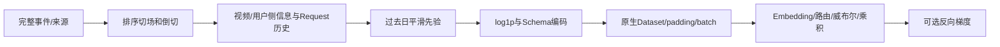

# 亲自调试数据流

脚本：[debug_dataflow.py](../../debug_dataflow.py)。默认使用真实测试会话，加载当前v5已训练checkpoint。直接用IDE的“Debug当前文件”即可；工作目录不必设为仓库根目录。解释器选择本仓库 `.venv/bin/python`。

实验实现位于 `pipeline/`。原来的 `code/` 目录会遮蔽Python标准库 `code`，导致PyCharm在执行脚本之前初始化调试器失败，现已重命名并更新全部代码导入和复现命令。调试脚本路径保持不变，直接重新启动Debug即可。历史日志、审计哈希和checkpoint保留原内容；其中的 `code/` 路径是当时运行记录。

## 直接看输出

在仓库根目录执行：

```bash
uv run python workspace/kr_time_budget/debug_dataflow.py
```

默认挑一个3～12屏的会话，完整重放它的聚合；前向最多8条Request。会打印事件、历史统计、标签编码、batch形状以及scale/shape/gamma/stay/prediction。

## 下断点

在脚本标有 `DEBUG 1` 到 `DEBUG 7` 的位置下IDE断点。所有关键变量都在同一个 `main()` 作用域，单步进入使用的是正式构建/Schema/模型实现。

命令行也可用pdb：

```bash
uv run python workspace/kr_time_budget/debug_dataflow.py --stop-at batch
uv run python workspace/kr_time_budget/debug_dataflow.py --stop-at requests encoded forward
uv run python workspace/kr_time_budget/debug_dataflow.py --pdb
```

`--pdb`默认停在前向之后。pdb中：`n`下一行，`s`进入函数，`c`继续，`q`退出；例如 `p batch_shapes`、`p batch['slate_tags']`、`p routing`、`p prediction_table`。需要进入某个计算函数时，把IDE断点放在该函数调用之前再单步进入。

当前[30＋6＋18分类](../8推倒重来/特征分类.md)可在forward断点查看`feature_categories`及`target_routing`。`routing`表示实际加载的v5路由，另有`budget_formula`标明原始分钟的公式入口；`target_routing`为新分类目标，req_idx公式标记pending，不能将二者混为一谈。

## 各步骤检查什么



| 断点阶段 | 关键局部变量 | 核对内容 |
| --- | --- | --- |
| `events` | `raw_user_events`、`sessionized_user`、`raw_events`、`provenance` | 19列原始值、来源文件/行号、切场、req0余数、屏内事件 |
| `requests` | `joined_events`、`raw_user_profile`、`user_profile`、`requests_rebuilt`、`requests_saved`、`event_membership` | 侧表、画像缺失处理、标签聚合、前屏反馈、label和每屏6事件 |
| `priors` | `prior_query`、`all_sessions`、`prior_observations`、`user_prior_rows`、`item_prior_rows`、`feature_rows` | 训练过去日/评估0506快照、平滑计数、未log特征 |
| `encoded` | `schema_input`、`manager`、`tag_vocab`、`tag_tokens`、`encoded_tag_ids`、`encoded`、`encoded_saved` | 哪些字段log1p；tag拆分、词表、截断与正式编码数据 |
| `batch` | `dataset`、`interaction`、`batch`、`batch_shapes` | DataLoader(batch_size=None)、dtype、padding和tensor形状 |
| `forward` | `model`、`field_embeddings`、`field_slices`、`routing`、`budget_x`、`content_x`、`scale`、`shape`、`gamma`、`stay`、`prediction_table`、`loss` | 独立预算表示、两个时钟的零切片、公式和最终预测 |
| `backward` | `gradients` | 内容梯度与冻结预算无梯度；需要--backward或--stop-at backward |

脚本逐段比较重放结果与正式产物，发现不一致立即指出字段。测试集的小batch预测还与训练入口保存的同request预测核对（该文件仅保存test结果）；小batch的loss只是调试值，不是全test指标。

## 挑选自己的样本

```bash
uv run python workspace/kr_time_budget/debug_dataflow.py --request-id 30052 --batch-size 4
uv run python workspace/kr_time_budget/debug_dataflow.py --split train
uv run python workspace/kr_time_budget/debug_dataflow.py --backward --stop-at backward
```

`--request-id`优先于`--split`。它会读取所在完整Session以正确重建历史，再取包含该Request的小batch。`--skip-priors`可跳过全部历史曝光的先验重算；其他环节照常核对。

## 运行范围

- events.parquet已经是完整19列去重后的事件；本脚本从这里重放，不重新跑全量CSV去重。`provenance`给出原CSV来源，source_row为不含表头的0起始数据行序号。
- 对一个用户重跑sessionize时，Session编号是局部编号；与保存的全局session_id不同。脚本按event_id对齐后核对分屏结果。
- 用户先验仍扫描完整Session表，物品先验仍用全体历史曝光，因为全局平滑基准不能仅用这个用户/这6个视频重算。筛出的调试会话很小，但这一步需要扫描完整历史。
- Schema直接加载train-fit结果，不在小样本上重新fit。正式编码与checkpoint需要同一份词表。
- 默认只做前向；`--backward`只算梯度，没有optimizer.step，不更新参数、不重训、不改写数据和checkpoint。

本次运行验证：[test会话+反向](../../logs/debug-dataflow-test.log)、[train会话](../../logs/debug-dataflow-train.log)。

PyCharm导入冲突修复验证：[本机pydevd先加载，再执行真实test会话及反向](../../logs/debug-pycharm-smoke.log)、[25项实验测试及标准库导入回归](../../logs/debug-import-fix-tests.log)。此次未连接IDE调试服务；验证覆盖调试器模块初始化和完整数据链路。
